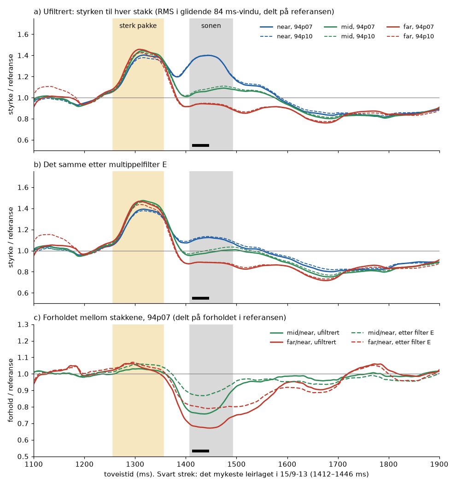
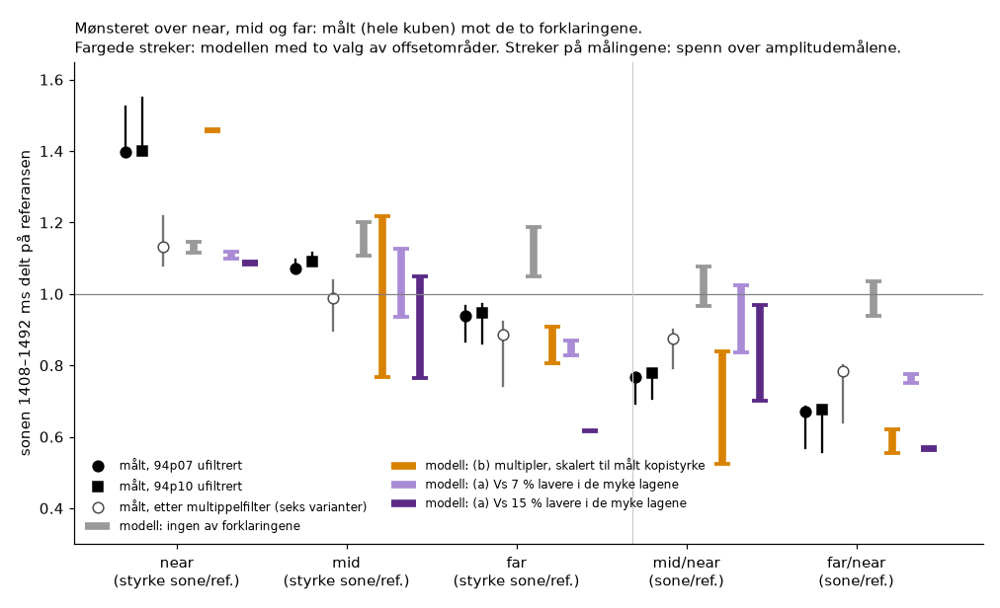

# Sleipner, ekte data: near, mid og far hver for seg

Kjørt 19. november 2026, kl. 22.50–23.10. Alt ligger i `/mnt/ssd/Data/force-hackathon-2026/review-linux/sleipner_ekte_stakkvis/`. Bare de åpne Sleipner-stakkene er brukt, og de er bare lest. Hvert tall her står i `results.json`.

## Svaret

1. **Det meste av mønsteret peker mot multipler, ikke mot lav Vs.** Underskuddet i far/near kommer først og fremst av at near er for sterk i sonen, ikke av at far er svak. Near ligger på 1,40 av referansen, mid på 1,07 og far på 0,94. Lav Vs skulle latt near stå og senket far kraftig.
2. **Mid/near i sonen er lav, ikke normal.** Den er 0,68–0,79 av referansen med alle direkte mål, i begge prosesseringene. Det uavklarte spørsmålet er dermed avgjort. Verdien 0,94–1,00 fra den første analysen kom fra et mål som bruker far som hjelpestakk, og det målet er ustabilt akkurat her (se under).
3. **Near er løftet av en speilvendt kopi av pakken 110 ms over.** Kopien forklarer 49–52 % av energien på near i 1366–1466 ms, 29–30 % på mid og 19–22 % på far. Seks multippelfiltre senker near fra 1,40 til 1,12–1,15, men endrer mid og far lite.
4. **Noe står igjen etter filtrene, og det kan ikke plasseres.** Far/near er fortsatt 0,77–0,79 og mid/near 0,86–0,89. Det ligger utenfor spredningen i sju andre like lange vinduer. Resten har samme form som modellen gir for omtrent 7 % lavere Vs i de myke lagene, men den kan like gjerne være multippelrester. Den strekker seg dessuten minst 100 ms under leirlaget.
5. **Et ulikt gain på stakkene kan ikke lage mønsteret.** Avviket sitter i ett vindu på rundt 100 ms, er likt i to prosesseringer og blir mindre med filtre som ikke rører gain.

Kort sagt: underskuddet på far kan ikke brukes som tegn på myk leire. En svak rest er verken vist eller utelukket.

## Hovedtall

Alle tall er sonen (1408–1492 ms) delt på referansen (1100–1900 ms utenom 1380–1560 ms), over hele kuben. Hovedtallet er RMS i vinduene. Parentesen er spennet over alle målene.

| Størrelse | 94p07 | 94p10 | Etter multippelfilter (seks varianter) | Sju andre 84 ms-vinduer i referansen |
|---|---|---|---|---|
| near, styrke | 1,40 (1,40–1,53) | 1,40 (1,40–1,55) | 1,12–1,15 (1,08–1,22) | 0,82–1,40 |
| mid, styrke | 1,07 (1,06–1,10) | 1,09 (1,09–1,12) | 0,98–1,01 (0,90–1,04) | 0,80–1,44 |
| far, styrke | 0,94 (0,87–0,97) | 0,95 (0,86–0,97) | 0,88–0,89 (0,74–0,92) | 0,77–1,45 |
| mid/near | 0,77 (0,68–0,77) | 0,78 (0,70–0,79) | 0,86–0,89 (0,70–0,91) | 0,96–1,04 |
| far/near | 0,67 (0,47–0,72) | 0,68 (0,48–0,70) | 0,77–0,79 (0,58–0,85) | 0,92–1,11 |
| far/mid | 0,88 | 0,87 | 0,88–0,90 | 0,96–1,11 |

Styrken til én stakk varierer mye fra vindu til vindu (0,8–1,45), fordi geologien gjør det. Forholdet mellom stakkene varierer lite (0,92–1,11). Det er derfor forholdene, og forskjellen mellom near, mid og far, som bærer konklusjonen.

Usikkerhet fra stedet i kuben, fra 18 delområder på omtrent 1 km² hver (94p07, RMS):

| Størrelse | Median | Standardfeil | Laveste–høyeste delområde |
|---|---|---|---|
| near | 1,41 | 0,011 | 1,28–1,47 |
| mid | 1,06 | 0,016 | 0,99–1,24 |
| far | 0,93 | 0,015 | 0,85–1,07 |
| mid/near | 0,76 | 0,009 | 0,71–0,85 |
| far/near | 0,67 | 0,011 | 0,59–0,75 |

94p10 gir det samme innenfor 0,01–0,02. Trase for trase er spredningen stor: median near 1,34 (16–84 %: 1,03–1,70), mid 1,02 (0,77–1,32), far 0,90 (0,68–1,17). Rundt brønnen (1,7 × 2,0 km, 22 218 traser) er near 1,40, mid 1,02, far 0,90, mid/near 0,73 og far/near 0,64.

*Figur 1: a) Styrken til near, mid og far mot tid, ufiltrert. I sonen (grå) blir near liggende høyt etter den sterke pakken (gul), mens mid og far faller tilbake. b) Etter multippelfilter E. c) Mid/near og far/near, før og etter filter.*

*Figur 2: Målt mønster (svart: ufiltrert, åpen ring: etter filter) mot kveldens syntetiske modell. Fargede streker spenner over modellens to valg av offsetområder.*

## Hva som er gjort

**Data og område.** Kubene har 249 × 468 traser med 12,5 m avstand, altså 3,1 × 5,85 km. Det er hele datasettet, og det samme området som den første analysen brukte. Et større område finnes ikke i filene. Jeg har derfor regnet på hele kuben, på et område rundt brønnen og på 18 delområder. Kubene er lest åtte inlinjer om gangen. Høyeste minnebruk i hovedkjøringen var 367 MB (fra kjøreloggen). En første prøvekjøring på 25 sekunder nådde 968 MB, fordi sidene fra de minnekartlagte filene ble liggende. Det ble rettet før hovedkjøringen.

**Punkt 1, styrken til hver stakk.** Fire mål per stakk: RMS i vinduet, middels absoluttverdi, middels envelope og et nabotrase-mål (produktet av traser 50 m fra hverandre, som tåler støy). I tillegg envelope-topper per reflektor.

**Punkt 2, mid/near og far/near.** Tolv mål: de fire vindusmålene, og åtte mål per reflektor på blokkmidlede traser (100 × 112 m) etter at mid og far er rettet inn mot near. De åtte er minste kvadrater begge veier, RMS-forhold, instrumentmål, medianer og envelope-topper. Reflektorene er plukket på fire måter (på near, mid, far og full), og svaret endrer seg med høyst 0,03.

**Hvorfor den første analysen fant normal mid/near.** Den brukte mid/near = Σ(mid·far)/Σ(near·far). Det målet forutsetter at near og far ligner hverandre. I sonen gjør de ikke det: korrelasjonen mellom near og far er 0,11 (94p07) og 0,07 (94p10), mot 0,41 og 0,40 i referansen. Nevneren blir da nesten tom. Uten innretting gir målet 1,68 og 2,50. Med innretting per reflektor gir det 0,70. Det kan altså gi nesten hva som helst her. Etter multippelfilter stiger korrelasjonen i sonen til 0,33–0,39.

**Punkt 3, gain og tidsinnretting.** RMS i 100 ms-vinduer (94p07):

| Vindu fra (ms) | 1100 | 1200 | 1300 | 1400 | 1500 | 1600 | 1700 | 1800 |
|---|---|---|---|---|---|---|---|---|
| near | 0,205 | 0,217 | 0,280 | 0,282 | 0,226 | 0,178 | 0,172 | 0,176 |
| mid | 0,179 | 0,189 | 0,246 | 0,192 | 0,189 | 0,151 | 0,149 | 0,152 |
| far | 0,128 | 0,137 | 0,173 | 0,119 | 0,116 | 0,102 | 0,110 | 0,108 |
| mid/near | 0,87 | 0,87 | 0,88 | 0,68 | 0,84 | 0,85 | 0,87 | 0,86 |
| far/near | 0,63 | 0,63 | 0,62 | 0,42 | 0,51 | 0,57 | 0,64 | 0,61 |

- Mid/near er jevn i alle vinduene unntatt ett. Et gain som skulle laget dette, måtte hatt et hakk på 100 ms på mid og far, eller en topp på near. Gain-kurver er glatte over mye lengre tid.
- Mønsteret er likt i 94p10, som har et annet gain grunt (far ved 800–900 ms er 0,213 mot 0,067).
- Multippelfiltrene endrer ikke gain, men fjerner 43–54 % av avviket i mid/near.
- Stakkene ligger riktig i tid. Mid ligger 1,6–1,7 ms etter near både i sonen og i referansen. Far ligger 1,6 ms etter near i sonen og 1,1–1,2 ms i referansen. Det er under én sample (2 ms). 94p07 og 94p10 har toppkorrelasjon ved null forsinkelse (0,94 på near, 0,87 på far).
- Far lar seg dårligere rette inn mot near i sonen: 44–46 % av reflektorene havner på kanten av søkevinduet (±8 ms), mot 31–32 % i referansen. Vindusmålene er upåvirket av dette.

**Punkt 4, kopien og filtrene.** Kopien av pakken 1256–1356 ms, målt i 1366–1466 ms:

| Stakk | Forsinkelse | Styrke 94p07 / 94p10 | Andel av energien | Styrke etter filter |
|---|---|---|---|---|
| near | 110 ms | −0,69 / −0,73 | 49 % / 52 % | −0,11 til −0,19 |
| mid | 112 ms | −0,36 / −0,38 | 29 % / 30 % | −0,03 til −0,05 |
| far | 120 ms | −0,25 / −0,27 | 19 % / 22 % | −0,04 til −0,10 |

Filtrene senker near til 0,80–0,82 av det den var, mid til 0,92 og far til 0,94. Av avviket (regnet i logaritmer) står 46–57 % igjen i mid/near og 59–65 % i far/near.

## Mot de to forklaringene

Fra `prediksjoner.json` (RMS-målene, to valg av offsetområder):

| | near | mid | far | mid/near | far/near |
|---|---|---|---|---|---|
| Modell: ingen av forklaringene | 1,12–1,15 | 1,11–1,20 | 1,05–1,19 | 0,97–1,08 | 0,94–1,04 |
| Modell: (b) multipler, skalert | 1,45–1,46 | 0,77–1,22 | 0,81–0,91 | 0,53–0,84 | 0,55–0,62 |
| Modell: (a) Vs 7 % lavere | 1,10–1,12 | 0,94–1,13 | 0,83–0,87 | 0,84–1,02 | 0,75–0,78 |
| Modell: (a) Vs 15 % lavere | 1,08–1,09 | 0,77–1,05 | 0,62 | 0,70–0,97 | 0,56–0,57 |
| **Målt, ufiltrert** | **1,40** | **1,07–1,09** | **0,94–0,95** | **0,77–0,78** | **0,67–0,68** |
| **Målt, etter filter** | **1,12–1,15** | **0,98–1,01** | **0,88–0,89** | **0,86–0,89** | **0,77–0,79** |

- **Near skiller klarest, og den sier multipler.** Målt 1,40, modellen 1,45–1,46 med multipler og 1,08–1,15 uten.
- **Forholdene alene skiller ikke.** Både multipler og 15 % lavere Vs gir far/near rundt 0,55–0,6 i modellen. Det var derfor nødvendig å se på stakkene hver for seg.
- **Ufiltrert passer ikke lav Vs oppå multipler.** Med 7 % lavere Vs og skalerte multipler gir modellen far 0,61–0,66. Målt far er 0,94.
- **Etter filter ligner resten på 7 % lavere Vs.** Målt 1,13 / 0,99 / 0,89 mot modellens 1,12 / 0,94 / 0,87 med det første offsetvalget. Uten noen forklaring gir modellen far 1,05–1,19.
- **15 % lavere Vs passer dårligere.** Modellen gir da far 0,62. Målt far er 0,74–0,97, avhengig av mål og filter.

## Hva som er usikkert

- **Nullnivået for near er ukjent.** Uten en modell av primærene kan ingen si hva near skulle vært i sonen. At 1,40 er for høyt, hviler på tre ting fra dataene selv: den speilvendte kopien, at filtrene tar near ned til 1,12–1,15, og at mid og far ikke følger near. Modellen gir det samme nivået (1,12–1,15), men den binder bare svakt til de ekte trasene.
- **Resten etter filtrene kan ikke tolkes.** Filtre på stakker rydder ikke pålitelig opp, det viste den syntetiske testen. Filtrene endrer far lite, så far etter filter er ikke et sikkert mål på primærene.
- **Resten er ikke knyttet til leirlaget alene.** Laget ligger på 1412–1446 ms. Etter filter er far/near 0,77–0,79 i 1400–1500 ms, 0,84–0,87 i 1500–1600 ms og 0,88–0,91 i 1600–1700 ms, målt mot de rene referansevinduene. Den kommer altså gradvis tilbake over 200–300 ms, slik et etterslep etter den sterke pakken ville gjort.
- **Bare sju sammenligningsvinduer.** Resten ligger 2,4–4,7 standardavvik utenfor dem, men standardavviket fra sju vinduer er grovt.
- **Støy.** RMS-målene trekker forholdene mot 1 der signalet er svakt. Nabotrase-målet, som tåler støy, gir lavere tall (mid/near 0,69, far/near 0,57). Sannheten ligger trolig mellom.
- **Modellen treffer ikke alle tre stakkene.** Mid avhenger sterkt av offsetvalget (0,77 eller 1,22 mot målt 1,07).
- **Kopien er bare målt under den ene sterke pakken.** Den første analysen fant at kopien ikke er like sterk under alle reflektorer. Det har jeg ikke undersøkt her.
- **94p10 har noen døde traser** (98,4 % brukt).

## Hva som ville endret konklusjonen

- **Gathers.** Hvis near i sonen fortsatt lå rundt 1,4 etter multippelfjerning før stakk, er multipler ikke hovedårsaken.
- **En modell som binder godt** (korrelasjon over 0,8) og gir near rundt 1,4 fra primærene alene.
- **En skjærlogg gjennom laget** som viser Vs 10–15 % under trenden. Da blir lav Vs en rimelig forklaring på resten.
- **Bedre multippelfjerning** som bringer far/near i sonen inn i 0,9–1,1. Da er det ingenting igjen å forklare med lav Vs.

## Filer

- `stakkvis.py`: all lesing av kubene og alle målene.
- `summary.py`: avledede tall, sammenligningsvinduer og modellens prediksjoner.
- `fig.py`: de to figurene.
- `results.json`: alle tallene. Nøkkelen `oppsummering` har tallene i dette notatet.
- `profiles_<versjon>.npz`: energi mot tid per stakk.
- `fig_stakkvis_tid.png`, `fig_stakkvis_monster.png`.
- `show.py`, `show2.py`, `show3.py`, `showpred.py`: utskrift av tabeller fra `results.json`.
