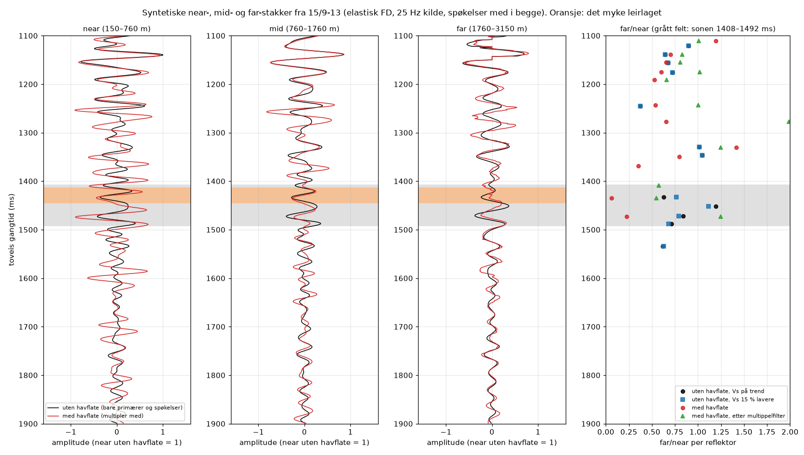

# Sleipner-testen: lav Vs eller multipler fra havflaten?

Kjørt 19. november 2026 om kvelden. Rettet samme kveld etter to uavhengige kontroller, som ligger i `../sleipner_verify_etterregning/NOTAT.md` og `../sleipner_verify_metode/NOTAT.md`. Alt ligger i `/mnt/ssd/Data/force-hackathon-2026/review-linux/sleipner_exp/`. Bare åpne data er brukt.

**Spørsmålet.** På Sleipner-stakkene (94p07 og 94p10) er far-stakken svak i forhold til near-stakken i sonen 1408–1492 ms. Far/near er 0,25–0,31 der, mot 0,38–0,68 (median 0,58) for reflektorene utenfor 1380–1560 ms. Sonen ligger altså på ca. 0,48 av referansen, og på 0,62–0,65 etter et multippelfilter på stakkene. To forklaringer er prøvd i en syntetisk modell av brønn 15/9-13: (a) lav skjærhastighet (Vs) i den myke leira, og (b) multipler fra havflaten i 81 m vann.

**Slik leses tallene.** «Sone/referanse» er verdien i sonen (1408–1492 ms) delt på verdien i referansen (1100–1380 ms og 1560–1900 ms). 1,00 betyr at sonen er som resten. To mål er brukt:

- **RMS-målet** sammenligner RMS-amplituden i de to tidsvinduene.
- **Reflektormålet** plukker reflektorer på fullstakken og tar medianen av far/near i sonen delt på medianen i referansen. Det er samme mål som ble brukt på de ekte stakkene.

## Det korte svaret

**Testen avgjør ikke hvilken forklaring som er riktig. Begge kan gi et underskudd på far av den størrelsen som er målt.**

1. **Multipler fra havflaten kan gi underskuddet.**
   - Uten havflate ligger far/near i sonen på 1,03–1,07 av referansen. Med havflate faller den til 0,22–0,52, avhengig av målet.
   - Multiplene i modellen er sterkere enn kopiene i de ekte stakkene. Skalert ned til den målte styrken blir sone/referanse 0,45–0,62 (0,57–0,62 med RMS-målet og på de sanne reflektorene).
   - Resultatet er skjørt. Kontrollen flyttet multiplene 4 ms i tid, og sone/referanse ble da alt fra 0,35 til 1,0. Modellen binder ikke til de ekte dataene bedre enn det.
2. **Lav Vs i ett homogent lag gir ikke underskuddet. Lav Vs som følger de myke lagene, gir det.**
   - Første forsøk senket Vs i ett lag (1358–1390 m). Det ga 1,01–1,12 for 7–20 % lavere Vs.
   - Kontrollen foreslo å senke Vs bare i de myke lagene i sonen: 1353–1362, 1366–1373, 1375–1399 og 1425–1435 m. Det er leirpakken uten to tynne harde lag, pluss ett mykt lag 30 m dypere.
   - Nye FD-kjøringer uten havflate gir da far/near sone/referanse 0,76–0,78 ved 7 % lavere Vs og 0,55–0,56 ved 15 % (RMS-målet og reflektormålet). Med reflektorer plukket på hver stakk for seg blir det 0,66 og 0,41.
   - Kontrollens egen regning uten FD (Zoeppritz, bare primærer) ga 0,70 og 0,44. FD bekrefter altså retningen og at 15 % er nok, men virkningen er svakere enn kontrollen fant.
3. **De to forklaringene gir ulikt mønster i near, mid og far hver for seg.** Det er dette som kan skille dem i de ekte dataene.
   - Multipler løfter near i sonen (1,4–1,5 av referansen, mot 1,1 uten) og senker far moderat (0,7–0,9).
   - Lav Vs i de myke lagene lar near stå (1,1) og senker far (0,6 ved 15 %).
   - Tabellene under «Forutsigelser» er laget for å sammenlignes med målinger på de ekte stakkene. De samme tallene ligger i `prediksjoner.json`.
4. **Underskuddet er ikke spesielt for sonen i modellen.** Kontrollene regnet RMS-målet i alle 84 ms-vinduer mellom 1100 og 1900 ms. Med havflate ligger 26–27 % av vinduene under 0,65, mot 9–12 % uten. Modellen forklarer altså ikke hvorfor underskuddet i de ekte dataene ligger akkurat i sonen.
5. **Hva mid gjør, avhenger av hvilke offset stakkene inneholder.**
   - Med offsetområdene fra den første målingen (near 150–760 m, mid 760–1760 m, far 1760–3150 m) gir multiplene også lav mid/near (0,30–0,53). I de ekte stakkene er mid/near 0,94–1,00 med hovedmålet fra den første målingen, og ca. 0,6–0,75 med det andre målet som ble brukt der.
   - Svakere kopier på mid forklarer ikke avviket. Kontrollen prøvde 2197 kombinasjoner av multippelstyrke på near, mid og far. Ingen ga både underskuddet på far og normal mid.
   - Forsinkelsen på kopiene i de ekte stakkene (110, 112 og 119 ms på near, mid og far) passer med offset rundt 360, 780 og 1500 m. Den passer ikke med områdene over.
   - Med offsetområder som gir de målte forsinkelsene (near 150–550 m, mid 575–1000 m, far 1200–1800 m) gir multiplene far/near 0,39–0,55 og mid/near 0,72–0,84 (0,82–0,84 med RMS-målet og på de sanne reflektorene). Lav Vs (15 %) i de myke lagene gir far/near 0,53–0,58 og mid/near 0,94–0,97. Begge ligger da nær det som er målt (0,48 og 0,94–1,00), og lav Vs nærmest på mid.
6. **Et multippelfilter på stakkene rydder ikke pålitelig opp.** Etter et trepunktsfilter av den typen som ble brukt på de ekte stakkene, blir sone/referanse alt fra 0,57 til 1,35, der fasiten er 1,03–1,07. At 0,62–0,65 står igjen etter filtrering i de ekte dataene, utelukker derfor ikke multipler.

Feilmargin fra rutenettet: Med 1 m rutenett i stedet for 2 m endres sone/referanse med høyst 0,02 uten filter (0,04 for forholdet mellom toppamplitudene) og høyst 0,09 etter filter. Spredningen mellom målene er altså mye større enn regnefeilen. De nye kjøringene med myke lag er ikke gjentatt på 1 m rutenett.

## Forutsigelser for near, mid og far hver for seg

Alle tall er sone/referanse fra FD-kjøringene (25 Hz kilde, eksakt NMO, 2 m rutenett). «Near alene» er RMS-amplituden til near-stakken i sonen delt på det samme i referansen, og tilsvarende for mid og far. Reflektormålet bruker den samme listen av reflektorer for alle forklaringene: de som plukkes på fullstakken uten multipler og med Vs på trenden (fire i sonen, sju i referansen).

**Offsetområdene fra den første målingen** (near 150–760 m, mid 760–1760 m, far 1760–3150 m):

| Forklaring | near alene | mid alene | far alene | far/near (RMS) | far/near (per reflektor) | mid/near (RMS) | mid/near (per reflektor) |
|---|---:|---:|---:|---:|---:|---:|---:|
| Ingen av forklaringene: ingen multipler fra havflaten, Vs på trenden | 1,15 | 1,11 | 1,19 | 1,03 | 1,07 | 0,97 | 1,00 |
| (b) Multipler fra havflaten, så sterke som modellen gir dem. Vs på trenden | 1,45 | 0,62 | 0,75 | 0,52 | 0,37 | 0,43 | 0,36 |
| (b) Multipler skalert til kopistyrken i de ekte dataene (near 0,73, mid 0,62, far 0,55 av modellens). Vs på trenden | 1,46 | 0,77 | 0,91 | 0,62 | 0,57 | 0,53 | 0,51 |
| (a) Vs 7 % under trenden i de myke lagene i sonen. Ingen multipler | 1,12 | 0,94 | 0,87 | 0,78 | 0,76 | 0,84 | 0,86 |
| (a) Vs 15 % under trenden i de myke lagene i sonen. Ingen multipler | 1,09 | 0,77 | 0,61 | 0,56 | 0,55 | 0,70 | 0,74 |
| (a)+(b) Vs 7 % lavere i de myke lagene og multipler med modellens styrke | 1,43 | 0,51 | 0,62 | 0,43 | 0,26 | 0,36 | 0,34 |
| (a)+(b) Vs 7 % lavere i de myke lagene og skalerte multipler | 1,44 | 0,62 | 0,66 | 0,46 | 0,37 | 0,43 | 0,39 |
| (a)+(b) Vs 15 % lavere i de myke lagene og multipler med modellens styrke | 1,42 | 0,41 | 0,63 | 0,44 | 0,21 | 0,29 | 0,25 |
| (a)+(b) Vs 15 % lavere i de myke lagene og skalerte multipler | 1,42 | 0,47 | 0,54 | 0,38 | 0,25 | 0,33 | 0,28 |
| (a) Vs 15 % under trenden i ett homogent lag 1358-1390 m (det første forsøket). Ingen multipler | 1,14 | 1,11 | 1,17 | 1,02 | 1,08 | 0,97 | 0,99 |

**Offsetområder tilpasset forsinkelsen på kopiene i de ekte stakkene** (near 150–550 m, mid 575–1000 m, far 1200–1800 m):

| Forklaring | near alene | mid alene | far alene | far/near (RMS) | far/near (per reflektor) | mid/near (RMS) | mid/near (per reflektor) |
|---|---:|---:|---:|---:|---:|---:|---:|
| Ingen av forklaringene: ingen multipler fra havflaten, Vs på trenden | 1,12 | 1,20 | 1,05 | 0,94 | 0,93 | 1,08 | 1,03 |
| (b) Multipler fra havflaten, så sterke som modellen gir dem. Vs på trenden | 1,43 | 1,19 | 0,66 | 0,46 | 0,39 | 0,83 | 0,82 |
| (b) Multipler skalert til kopistyrken i de ekte dataene (near 0,73, mid 0,62, far 0,55 av modellens). Vs på trenden | 1,45 | 1,22 | 0,81 | 0,55 | 0,55 | 0,84 | 0,82 |
| (a) Vs 7 % under trenden i de myke lagene i sonen. Ingen multipler | 1,10 | 1,13 | 0,83 | 0,75 | 0,75 | 1,02 | 0,98 |
| (a) Vs 15 % under trenden i de myke lagene i sonen. Ingen multipler | 1,08 | 1,05 | 0,62 | 0,57 | 0,58 | 0,97 | 0,94 |
| (a)+(b) Vs 7 % lavere i de myke lagene og multipler med modellens styrke | 1,43 | 1,15 | 0,53 | 0,37 | 0,24 | 0,81 | 0,74 |
| (a)+(b) Vs 7 % lavere i de myke lagene og skalerte multipler | 1,44 | 1,16 | 0,61 | 0,42 | 0,38 | 0,80 | 0,78 |
| (a)+(b) Vs 15 % lavere i de myke lagene og multipler med modellens styrke | 1,42 | 1,11 | 0,45 | 0,32 | 0,08 | 0,78 | 0,63 |
| (a)+(b) Vs 15 % lavere i de myke lagene og skalerte multipler | 1,43 | 1,10 | 0,45 | 0,32 | 0,21 | 0,77 | 0,75 |
| (a) Vs 15 % under trenden i ett homogent lag 1358-1390 m (det første forsøket). Ingen multipler | 1,11 | 1,20 | 1,05 | 0,94 | 0,95 | 1,07 | 1,04 |

Slik kan tabellene brukes:

- **Near alene** er det tydeligste skillet. Multipler gir 1,4–1,5 i begge offsetsettene. Uten multipler er near 1,1, uansett Vs.
- **Far alene** faller med begge forklaringene (0,6–0,9) og skiller dem dårlig.
- **Mid/near** skiller bare hvis offsetområdene er kjent. Med de tilpassede områdene gir multipler ca. 0,8 og lav Vs ca. 1,0.
- **Begge sammen** gir far/near 0,1–0,5. De fleste kombinasjonene ligger under det som er målt (0,48).
- «Skalert» betyr primærer pluss en andel av multiplene: 0,73 på near, 0,62 på mid og 0,55 på far. Andelene er kopistyrken målt i de ekte stakkene delt på modellens (kontrollens `p2_scale.py`). De samme andelene er brukt i begge offsetsettene.
- Forsinkelsen på første kopi i modellen er 111, 118 og 131 ms med de første offsetområdene og 111, 114 og 120 ms med de tilpassede. Målt i de ekte stakkene: 110, 112 og 119 ms.

## Tallene fra første forsøk (ett homogent lag)

Hovedvarianten: 25 Hz Ricker-kilde, eksakt NMO for primærene, ytre mute ved 48°, 2 m rutenett, offsetområdene fra den første målingen. Kolonnen «sone/referanse» er reflektormålet.

| Tilfelle | far/near i sonen | far/near utenfor | **Sone/referanse** | Sone/referanse, RMS-mål | mid/near sone/referanse | Antall reflektorer (sone / utenfor) |
|---|---:|---:|---:|---:|---:|---|
| Uten havflate, Vs på trend | 0,77 | 0,73 | **1,07** | 1,03 | 1,00 | 4 / 7 |
| Uten havflate, Vs −7 % i laget | 0,75 | 0,73 | **1,04** | 1,01 | 1,00 | 4 / 7 |
| Uten havflate, Vs −15 % i laget | 0,78 | 0,73 | **1,08** | 1,02 | 1,00 | 4 / 7 |
| Uten havflate, Vs −20 % i laget | 0,81 | 0,73 | **1,12** | 1,05 | 0,99 | 4 / 7 |
| Med havflate, Vs på trend, de samme reflektorene | 0,26 | 0,70 | **0,37** | 0,52 | 0,36 | 4 / 7 |
| Det samme, reflektorer plukket på stakken med multipler | 0,14 | 0,65 | **0,22** | 0,52 | 0,30 | 3 / 10 |
| Med havflate, Vs på trend, etter multippelfilter | 0,57–1,17 | 0,97–1,01 | **0,57–1,21** | 1,08 | 0,66–0,88 | 3–4 / 7–10 |
| Med havflate, Vs −15 % i laget | 0,22 | 0,65 | **0,34** | 0,45 | 0,29 | 3 / 10 |
| Med havflate, Vs −15 % i laget, etter multippelfilter | 1,16 | 1,01 | **1,14** | 0,97 | 0,92 | 3 / 10 |
| Målt på Sleipner | 0,25–0,31 | 0,58 | **0,48** | – | 0,94–1,00 (hovedmålet) eller ca. 0,6–0,75 (det andre målet) | 5 / 21 |
| Målt på Sleipner, etter filter | 0,3–0,5 | 0,60–0,68 | **0,62–0,65** | – | – | – |

- Verdien 0,14 er medianen av bare to reflektorer. Den tredje ga negativt forhold og ble forkastet.
- Vs −7 % i laget gir 1,04 mot 1,07 på trenden, altså litt ned, men langt fra 0,5.
- Far/near for de fire sanne reflektorene i sonen blir 0,02, 0,30, 0,23 og 0,31 med havflate.
- Med havflate er near i sonen 1,45 × referansen (1,15 uten), mid 0,62 × (1,11 uten) og far 0,75 × (1,19 uten). Underskuddet i modellen kommer altså mest av at near løftes og mid faller.
- Multiplene alene er 1,1 ganger så sterke som primærene på near, og 0,6 ganger på mid og far.

## Slik er testen bygget

- **Modell.** 1D-modell fra de åpne FORCE 2020-loggene i 15/9-13 (Vp fra lydloggen, tetthet fra tetthetsloggen), 0–2300 m, 81 m vann.
  - Gangtiden er kalibrert mot brønnens sjekkskuddkurve (Sleipner 2019-referansedatasettet). Laget fra første forsøk (1358–1390 m under havnivå) ligger da på 1414–1445 ms.
  - Vs følger en lokal trend fra målt skjærlogg i 16/7-6, øvre Hordaland: Vs = 46 + 0,343 · Vp (2573 målinger, spredning 46 m/s). Det gir Vs 754 m/s og Vp/Vs 2,73 i laget. 7 % lavere Vs er omtrent én spredning under trenden, og 15 % er to og en halv.
  - De myke lagene er cellene i sonen der akustisk impedans ligger under glidende middel over 61 m (kontrollens definisjon, `softbeds_mask` i `slp.py`).
  - Tettheten er hentet fra en Gardner-trend der hullet er utvasket (Utsira-sanden) og der loggen mangler (over 470 m). Havbunnen får Vp 1841 m/s og tetthet 1,95 g/cm³, som gir refleksjonskoeffisient 0,40.
- **Modellering.** Elastisk FD med operatoren fra Troll-prosjektet (`07_fd_elastic.py`): 2 m rutenett, 8. orden, 120 celler randsone. Kilde 6 m og mottakere 8 m under havflaten, offset 150–3150 m hver 25 m, 2,5 s opptak, 35 Hz Ricker-kilde. Data for 25 Hz er regnet ut fra de samme kjøringene (eksakt, fordi modelleringen er lineær i kildepulsen).
  - **Med havflate:** speilmetoden. Modellen speiles om z = 0, og en kilde med motsatt fortegn settes i speilpunktet. Trykket i havflaten blir da nær null, men ikke eksakt (se «Kontroller»).
  - **Uten havflate:** vannet fortsetter oppover i en absorberende sone. Speilkilde og speilmottakere gir de samme spøkelsene som med havflate, men ingen multipler fra havflaten. Forskjellen mellom de to kjøringene er altså bare multiplene.
- **Behandling.** Den direkte bølgen trekkes fra med en kjøring med bare vann. Fasen fra 2D-linjekilden fjernes. Så NMO, mute og stakk i to sett offsetområder (se «Det korte svaret», punkt 5).
- **Måling.** Reflektorer plukkes på fullstakken (0,20 near + 0,32 mid + 0,45 far), near og far rettes inn mot mid, og far/near = Σ(far·mid)/Σ(near·mid) i ±16 ms. Det er samme regel som i `sl_events_lib.py`, som ble brukt på de ekte stakkene. Multippelfilteret er trepunktsfilteret fra `fm_sl_demult.py`, med koeffisienter målt i de syntetiske stakkene på samme måte.

## Kontroller

| Kontroll | Resultat |
|---|---|
| Speilmetoden på en liten modell (81 m vann, én reflektor): kopi/reflektor skal være −0,757 | −0,742 ved 0 m, −0,755 ved 200 og 400 m, −0,759 ved 600 m; forsinkelse 109 ms |
| Uten havflate skal det ikke være noen kopi | −0,017 til +0,004 |
| Primæren er lik med og uten havflate | Korrelasjon 1,0000, amplitudeforhold 0,9997 |
| Trykket i havflaten | Ikke eksakt null. Kontrollen fant at Devito midler skjærmodulen ensidig ved speilbildet av havbunnen, så speilmodellen er ikke et eksakt speilbilde. Kontrollen målte virkningen på første kopi til under 0,5 % på en liten modell. Jeg kjørte i tillegg ett tilfelle (med havflate, Vs på trend) med kontrollens eksakte variant, der speilet er helt symmetrisk. Stakkene korrelerer 0,999–1,000 med standardkjøringen (forskjell 0,6 % på near, 1,6 % på mid og 5 % på far). Sone/referanse endres med høyst 0,02: fra 0,52 til 0,51 med RMS-målet og fra 0,37 til 0,36 med reflektormålet (0,03 for forholdet mellom toppamplitudene) |
| Tidsaksen: havbunnsrefleksjonen ved 150 m offset | 149,0 ms, ventet 149,2 ms |
| NMO flater ut primærene (sterk reflektor ved 1245 ms, ut til 2 km) | Avvik høyst 1,2 ms; med hyperbolsk NMO høyst 3,5 ms |
| FD uten havflate mot ren Zoeppritz-syntetikk med samme spøkelser | Korrelasjon 0,98 (near), 0,99 (mid), 0,99 (far) |
| FD med havflate mot stråleteori med vannlagsmultipler | Korrelasjon 0,96 (near), 0,98 (mid), 0,98 (far); sone/referanse 0,24–0,53 mot 0,22–0,52 i FD |
| Virkningen av 15 % lavere Vs i ett lag: FD mot Zoeppritz (1380–1500 ms) | Korrelasjon 0,98 (near), 0,99 (mid), 0,995 (far). Styrke i FD: 1,01, 0,95 og 0,87 av Zoeppritz |
| Virkningen av lav Vs i de myke lagene: FD mot Zoeppritz, far/near sone/referanse, RMS-mål | 7 %: 0,78 i FD, 0,67 med min Zoeppritz og 0,70 med kontrollens. 15 %: 0,56, 0,39 og 0,44 |
| Stabilitet | Courant-tall 0,46 i hovedkjøringene, grensen er 0,55; alle kjøringer endelige |
| Samme svar på to maskiner | Vann-kjøringen fra Linux-PC-en og fra den leide maskinen er identiske (avvik 0) |
| Rutenett 1 m mot 2 m (med havflate, Vs på trend) | Sone/referanse 0,22 mot 0,22 (reflektorer plukket på stakken med multipler), 0,36 mot 0,37 (de sanne reflektorene) og 0,51 mot 0,52 (RMS-mål). Stakkene korrelerer 0,996–0,997. Med 35 Hz kilde 0,987–0,991 |

Kopiene under sterke reflektorer, målt på to måter:

| Stakk | Modell, målt på stakken selv | Ekte stakker, målt på stakken selv | Modell, multiplene alene under én reflektor (1156 ms) |
|---|---|---|---|
| near | −0,94 ved 110 ms | −0,68 ved 110 ms | −0,93 ved 111 ms |
| mid | −0,52 ved 109 ms | −0,37 ved 112 ms | −0,60 ved 118 ms |
| far | −0,75 ved 120 ms | −0,28 ved 119 ms | −0,51 ved 131 ms |

- Bare de to første kolonnene er målt på samme måte og kan sammenlignes direkte.
- Riktig første kopi på near for én reflektor alene er −0,75. Tallene −0,93 og −0,94 er for sterke fordi kopier av nabo-reflektorer legger seg oppå.
- Kontrollen fant «kopier» på −0,46 til −1,16 på near også i stakkene uten havflate. Styrken er altså ikke et pålitelig mål. Det er forsinkelsen (110 og 220 ms) som peker på multipler i de ekte dataene.

## Hvor følsomt er svaret?

Sone/referanse for far/near med offsetområdene fra den første målingen. Hver rute viser spennet over fem mål: reflektormålet og forholdet mellom toppamplitudene på to reflektorlister, pluss RMS-målet.

| Variant | Uten havflate, Vs på trend | Med havflate, ufiltrert | Med havflate, etter filter |
|---|---:|---:|---:|
| Hovedvariant | 0,98–1,07 | 0,22–0,52 | 0,57–1,35 |
| Strekk-mute 50 % i stedet for 48° | 1,03–1,05 | 0,32–0,52 | 0,70–1,30 |
| Hyperbolsk NMO med Vrms | 1,06–1,10 | 0,24–0,51 | 0,48–0,85 |
| 35 Hz kilde (høyere frekvens enn dataene) | 0,94–1,26 | 0,61–0,68 | 0,65–0,97 |
| 1 m rutenett i stedet for 2 m | – | 0,22–0,51 | 0,64–1,30 |
| Havbunn-R 0,37 i stedet for 0,40 | 0,95–1,06 | 0,10–0,50 | 0,80–1,23 |
| Havbunn-R 0,43 | 1,00–1,07 | 0,20–0,53 | 0,87–1,46 |

For kjøringene uten havflate er bare målene på de sanne reflektorene og RMS-målet tatt med.

- **Med havflate er det et underskudd i alle varianter** (0,1–0,7).
- **Uten havflate og med Vs senket i ett lag kommer ingen mål i nærheten av 0,5.** Mine mål spenner 0,85–1,32 over alle variantene og Vs 0–20 % under trenden. Kontrollenes egne mål ga ned til 0,72.
- **Etter filteret spriker svaret** fra 0,5 til 1,5. Filteret bommer fordi kopiene fra flere reflektorer ligger oppå hverandre når koeffisientene måles, og fordi kopien er smurt utover på far.

## Hvorfor geometrien betyr så mye for lav Vs

Ved én enkelt grense (bunnen av laget fra første forsøk) gir 15 % lavere Vs et klart fall på far: far/near går fra 1,12 til 0,70. Men laget er bare 32 m tykt, ca. én bølgelengde i toveis gangtid. Toppen av laget får samtidig en ny refleksjon som bare synes på far, med motsatt virkning. I stakken endres bølgeformen på far tydelig (37 % av RMS-amplituden i 1380–1500 ms), men nivået endres ikke.

Når Vs senkes i de myke lagene hver for seg, faller nivået på far i hele sonen (far alene fra 1,19 til 0,61 ved 15 %). Kontrollen fant at bare det å flytte bunnen av laget fra 1390 til 1396 m endrer svaret merkbart. Svaret for lav Vs avhenger altså sterkt av nøyaktig hvor Vs er lav, og det vet vi ikke uten en skjærlogg.

## Hva testen ikke kan si

- **Hvilken forklaring som er riktig.** Begge gir underskuddet. Near, mid og far hver for seg i de ekte stakkene kan skille dem (se «Forutsigelser»).
- **2D og flate lag.** Kilden er en linjekilde, og amplituden avtar annerledes med avstand enn i 3D. Forholdet mellom reflektorer påvirkes lite, men det er ikke regnet i 3D.
- **Prosesseringen er ukjent.** Hastighetene, muten, offsetområdene, eventuell demultippel og pulsen i 94p07 og 94p10 er ikke kjent. De tilpassede offsetområdene er valgt fra forsinkelsen på kopiene, ikke hentet fra en prosesseringsrapport.
- **Reflektorene ligger ikke på samme sted som i de ekte dataene.** Modellen binder svakt til den ekte trasen ved brønnen (korrelasjon 0,45–0,59 med ±6 ms forskyvning). Virkningen av multiplene tåler bare noen få millisekunder forskyvning.
- **Havbunnen er ikke målt.** Lydloggen over ca. 470 m er redigert, og tettheten mangler der. Havbunn-R er derfor antatt (0,40). Variantene 0,37 og 0,43 gir samme svar.
- **Vs er en trend, ikke en måling.** 15/9-13 har ingen skjærlogg. Om Vs er lav i de myke lagene, og hvor mye, er ikke kjent. Vs i de grunneste sedimentene er satt høyere enn den trolig er (minst 619 m/s), for at rutenettet skal holde.
- **De myke lagene er tynne.** De er 7–24 m tykke, og rutenettet er 2 m. Disse kjøringene er ikke gjentatt på 1 m rutenett.
- **Et prosesseringstrinn som forklaring** er ikke testet.
- **Få reflektorer.** Sonen har 3–4 plukkede reflektorer i modellen, så medianene er grove. RMS-målet er derfor tatt med ved siden av.

## Filer

| Fil | Innhold |
|---|---|
| `s1_model.py`, `model_1d.npz`, `model_info.json` | Modellen og hvordan den er laget |
| `s2_fd.py`, `gather_<oppsett>_<tilfelle>.npz` | FD-kjøringene. Oppsett `FS` er med havflate og `G` uten. Tilfellene `sb07` og `sb15` er lav Vs i de myke lagene, `m07`, `m15` og `m20` er lav Vs i ett lag |
| `s2v_validate.py`, `validation_images.json` | Kontrollen av speilmetoden |
| `slp.py`, `s3_stack_measure.py`, `stacks.npz`, `results.json` | Behandling, stakker og alle målene. I `results.json` er `main` offsetområdene fra den første målingen og `reallag` de tilpassede. Datasett med `FSs_` foran har skalerte multipler |
| `s7_predictions.py`, `prediksjoner.json`, `prediksjoner_tabeller.md` | Forutsigelsene for near, mid og far hver for seg |
| `s4_grid_convergence.py`, `grid_convergence_detail.json` | 2 m mot 1 m rutenett. Kilden settes inn per rutenettpunkt, så 2 m-dataene er 4 ganger sterkere enn 1 m-dataene. Den faste faktoren er tatt bort her |
| `s5_figure.py`, `fig_sleipner_syntetisk.png` | Figuren fra første forsøk (ett lag, offsetområdene fra den første målingen) |
| `s6_table.py`, `tables.md` | Tabeller for alle varianter |
| `run_extra.sh`, `run_soft.sh`, `run_sym.sh`, `box_logs/` | Kjøreskript og logger fra de leide maskinene |

Skriptene leser mappen fra miljøvariabelen `SLEIPNER_EXP_ROOT` og kan kjøres et annet sted uten endringer. `s1_model.py` trenger i tillegg LAS-filene og brønnfila (`FORCE_LAS_DIR`, `SLEIPNER_WELLS_JSON`).

Hvor kjøringene ble gjort: `gather_FS_val0.npz`, `gather_FS_val1.npz` og `gather_G_water_linux.npz` er fra Linux-PC-en. Alle de andre er fra to leide maskiner hos Vast.ai. Fra den første: de ti hovedkjøringene, havbunnsvariantene, `gather_G_val0.npz`, `gather_G_val1.npz` og de to 1 m-kjøringene (`*_dx1.npz`). Fra den andre: de fire kjøringene med myke lag (`*_sb07.npz`, `*_sb15.npz`) og kjøringen med eksakt speil (`gather_FS_trend_sym.npz`).
