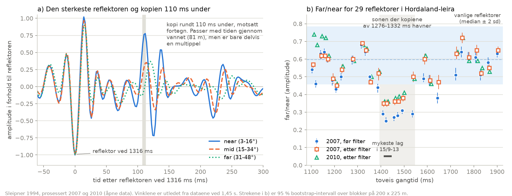

# Seismisk forward modeling for duktil, smektittrik Grønnleire

Vurdering for Nature's Plug, 19. november 2026. Far/near-testen på Sleipner (2.10) kom til samme kveld. Ingenting er bygget eller endret i appen. Tallene er regnet på åpne data, og skriptene ligger i `regnestykker/`. Litteraturen er lest av sju agenter og etterprøvd av ni andre (kildene ble åpnet på nytt, tallene regnet om uavhengig, og en kritiker lette etter hull). De viktigste kildene har jeg lest selv.

## Kort svar

**Anbefaling: bygg en liten «hva om»-modell i brønnbindingspanelet. Ikke bygg demping, viskoelastisk modellering, AVA-panel eller syntetiske treningsdata nå.**

Forward modeling er nyttig for oss som et verktøy for å prøve scenarier og vise hva seismikken *ikke* kan se. Det er ikke en detektor for duktil leire.

1. **Poststakk-seismikk registrerer kontraster ved skarpe grenser, ikke egenskapene inni et lag.** I Nini-4 er toppen av den smektittrike leira skarp (12 m) og gir en refleksjonskoeffisient på −0,06 til −0,08. På norsk side vet vi ikke om toppen er skarp.
2. **Lav Vs er ikke noe særtrekk som seismikken kan bruke.** Vs faller i takt med Vp, slik den gjør i enhver mykere slamstein. Det som er spesielt for leira i Nini-4, er 5 % av Vs. En full stakk merker det ikke. På delstakker ligger det på grensen av det som skiller seg fra spredningen mellom vanlige reflektorer (2.10).
3. **Vi finner ingen tegn til at leira demper mer.** En rask sjekk av VSP mot sonisk logg i Nini-4 viser ingen målbar dispersjon i Horda. En norsk studie finner lav demping i noen grunne, trege enheter. Poststakk-kubene våre kan uansett ikke måle slike forskjeller.
4. **Elastiske egenskaper beviser ikke duktilitet, og duktilitet beviser ikke barriere.** Forskningen peker på porøsitet, konsolideringshistorie og forholdene i brønnen. Bransjen kvalifiserer krypende leire med bondlogger og trykktester.
5. **Far/near-testen på Sleipner fant ingen sikker anomali (2.10).** Ved det mykeste leirlaget er far svakere enn ved de sterkeste reflektorene, også etter at multiplene er fjernet og i en annen prosessering av de samme dataene. Det meste skyldes trolig kopier av de sterke reflektorene over, og resten ligger innenfor vanlig variasjon når det måles med en uavhengig metode. Leire ville dessuten kreve 12–20 % lavere Vs, mens de nærmeste skjærloggene viser høyst 7 %.

Det mest lovende seismiske sporet i kildene er ikke forward modeling, men **seismisk mønster**: Grønnleire som er omrørt av massestrømmer, ser kaotisk ut på seismikk og tetter dårligere.

Og én kilde bør du lese selv: Øygarden, Løseth og Njerve (2015) bruker brønn 34/8-A-33 H **over Visund** og beskriver nettopp smektittrike eocene leirsteiner i Hordalandgruppen, med modellert AVO. [K7]

## 1. Hva vi allerede har

- **Akustisk forward modeling i 1D finnes i appen.** `synthetic()` i `natures-plug/seismic/wells.js` lager refleksjonskoeffisienter fra impedans og folder dem med en wavelet. Brønnbindingen sammenligner syntetisk og ekte trase i seks brønner (fem norske og Nini-4).
- **Kubene er ferdig stakket.** TNE01, GN1101, Sleipner 94p07 og Nini er full stakk. Bare Sleipner har near/mid/far-stakker. De er nå lest inn og testet (2.10).
- **Én brønn har alt.** Nini-4 har målt Vp, Vs, tetthet, smektitt og VSP over samme grense.
- **Loggprediksjonen slo ikke dybdetrenden.** Det sier lite om det vi vurderer her. En dybdetrend ligger under seismikkens frekvensbånd, så absolutte loggverdier fra poststakk-amplituder taper lett mot den. Resultatet sier ikke noe om kontraster eller mønster.

## 2. Tallene

### 2.1 Modell A og modell B, målt i Nini-4

Medianer av loggprøvene fra råfila til GEUS.

| | A: slamstein over (Lark L1, 1600–1700 m) | B: smektittrik leire (Horda, 1700–1760 m) | Endring |
|---|---|---|---|
| Vp | 2438 m/s | 2215 m/s | −9 % |
| Vs | 1012 m/s | 811 m/s | −20 % |
| Tetthet | 2,30 g/cm³ | 2,17 g/cm³ | −5 % |
| Vp/Vs | 2,43 | 2,74 | +0,31 |
| Akustisk impedans | 5637 | 4834 | −14 % |
| Skjærmodul | 2,4 GPa | 1,4 GPa | −39 % |
| Youngs modul | 6,6 GPa | 4,1 GPa | −38 % |
| Poissons forhold | 0,40 | 0,42 | |
| Smektitt (XRD, andel av hele bergarten) | 0–3 % | 26–54 % | |

- **Modulene er ikke mekaniske egenskaper i den forstand en bergmekaniker mener.** De er udrenerte, målt ved loggfrekvens og ved svært små tøyninger. Youngs modul og Poissons forhold styres i stor grad av porevannet. Skjærmodulen er den eneste som ikke gjør det.
- **Loggene er pålitelige over grensen.** Hullet er i mål (kaliper 8,3–8,7 tommer i begge lag), tetthetskorreksjonen er liten og lik (−0,01 g/cm³), brønnen er vertikal, og skjærloggen er fra dipol. Slamtypen har jeg ikke sjekket.
- **Smektitten er målt på seks borekaksprøver og to kjerner** i Horda.

### 2.2 Refleksjonen fra toppen av leira

- **Toppen er skarp.** Impedansen faller gjennom 10–90 % av trinnet på 12 m (1690–1702 m), og det meste skjer på 3 m.
- **Størrelsen avhenger av hva som regnes med.** Mellom intervallmedianene er refleksjonskoeffisienten −0,076. Mellom de nærmeste 26 m over og under er den −0,056. Seismikken ser noe imellom.
- **Leira er ikke ensartet.** Ved 1713–1716 m ligger en hardere stripe der impedansen er tilbake på nivået over.
- **Under leira ligger en 24 m tykk sand** (1766–1790 m) før Sele-formasjonen. Bunnen er derfor to overganger på til sammen +0,08.

Vinkelavhengighet, eksakt Zoeppritz fra intervallmedianene:

| Vinkel | 0° | 10° | 20° | 30° | 40° |
|---|---|---|---|---|---|
| Toppen av leira | −0,076 | −0,072 | −0,064 | −0,052 | −0,043 |

Refleksjonen er myk og svekkes med vinkelen: negativ intercept og positiv gradient (+0,10).

### 2.3 Er den lave skjærhastigheten noe spesielt?

Dette er det viktigste regnestykket, og det første utkastet mitt brukte feil sammenligning. Vp/Vs stiger alltid når en slamstein blir mykere. Spørsmålet er om Horda har lavere Vs enn en vanlig slamstein med samme Vp.

| Hva leira sammenlignes med | Vs i leira | Gradient | Far/near | Full stakk 0–30° |
|---|---|---|---|---|
| Målt | 811 m/s | +0,10 | 0,72 | −0,067 |
| Lokal Vs–Vp-trend i Lark (808–1700 m) | 855 m/s | +0,08 | 0,81 | −0,069 |
| Samme Vp/Vs som laget over | 912 m/s | +0,04 | 0,92 | −0,073 |

- **Horda ligger 45 m/s (5 %) under den lokale trenden.** Det er det som er spesielt. Resten av Vs-fallet følger av at leira er mykere.
- **På en full stakk utgjør det 3–4 % av amplituden.** Selv mot den urimelige sammenligningen nederst er forskjellen bare rundt 8 % (5–13 % etter vinkelområde og vekting).
- **På vinkelstakker er forskjellen 0,72 mot 0,81 i far/near.** Det er lite, og to andre ting gir like store utslag (2.4).

Stakkene er regnet med lik vekt per grad og antatte vinkelområder (near 5–15°, far 25–35°). Ekte stakker vektes etter fold og mute.

### 2.4 Det som gir samme utslag som lav Vs

- **Anisotropi.** En forskjell i Thomsens δ på ±0,05 mellom de to leirene endrer gradienten med ±0,025, like mye som hele forskjellen mellom målt Vs og trenden. δ er ikke målt for denne leira. For en paleogen takbergart i sentrale Nordsjøen er δ oppgitt til 0,02–0,03 og ε til 0,15–0,22. [K19]
- **Demping.** Ukompensert demping svekker far-stakken mer enn near-stakken. Dette er min egen vurdering, ikke hentet fra en kilde.

### 2.5 Tykkelse, tuning og gradvise overganger

- **Laget er tykt nok.** Leira er 60–100 m i Nini-4 (54–90 ms toveis tid) og 141–430 m i prediktoren på norsk side (omtrent 130–430 ms).
- **Tuning rammer tynne lag.** En kile med 25 Hz Ricker forsterkes mest ved 17 m (1,4–1,5 ganger), ved 11 m for 40 Hz og 7 m for 60 Hz. Topp og bunn er fri for interferens fra ca. 40 m.
- **En gradvis topp svekker refleksjonen raskt.** En overgang på 20 m beholder 60–70 % av amplituden ved 25–30 Hz, 30 m beholder 25–45 %, og 40 m under 20 %. Bransjen beskriver at smektittinnholdet avtar gradvis oppover og østover i Grønnleira [K5], så en gradvis topp er det vi må vente på norsk side.

### 2.6 Demping: hvor stort signal, og hva det drukner i

Forskjellen mellom en leire med Q = 40 og en med Q = 80, sett på en refleksjon under laget (30 Hz Ricker). Dette er øvre grenser, fordi demping i lagene over smalner spekteret først.

| Tykkelse | Amplitude ved 30 Hz | Amplitude ved 60 Hz | Sentroidefrekvens |
|---|---|---|---|
| 60 m (Nini-4) | −0,6 dB | −1,1 dB | −0,4 Hz |
| 100 m | −0,9 dB | −1,8 dB | −0,7 Hz |
| 200 m | −1,8 dB | −3,7 dB | −1,3 Hz |
| 400 m | −3,7 dB | −7,4 dB | −2,5 Hz |

Så mye varierer sentroidefrekvensen mellom to vinduer på 300 ms uten at demping er forklaringen:

| Kilde til variasjon | Størrelse |
|---|---|
| Tilfeldig reflektivitet med samme wavelet | 2,8 Hz (standardavvik) |
| Nini-4s egen reflektivitet med én fast wavelet | 35,6–40,8 Hz |
| De fire kubene, fra trase til trase | 2,8–6,4 Hz |
| Samme etter midling over 25 × 25 nabotraser | 1,5–2,8 Hz |

- **Variasjonen er geologi, ikke tilfeldig støy.** Uavhengige traser ville midlet seg ned til 0,1 Hz. Nabotraser har samme lagdeling, så midling hjelper ikke.
- **Testen dekker én metode.** Den viser at forskjellen mellom to vinduer i samme trase ikke kan brukes. En regresjon over hele kuben mot leiras tykkelse er ikke prøvd. Den ville uansett gitt effektiv demping, ikke leiras egen.
- **Nini-kuben er spektralt hvitet og tidsvariant filtrert** i prosesseringen. De tre andre kubene har ingen prosesseringshistorikk i filene.

### 2.7 Måler vi mer demping i leira? VSP mot sonisk logg i Nini-4

I et dempende medium går høye frekvenser raskere enn lave. Da blir VSP-tidene (ca. 50 Hz) lengre enn tidene fra den soniske loggen (ca. 10 kHz). Jeg har sammenlignet de 52 VSP-nivåene med den integrerte soniske loggen.

| Intervall | VSP | Sonisk | VSP tregere med | Q som svarer til det |
|---|---|---|---|---|
| Lark, 820–1700 m | 370,3 ms | 363,7 ms | 1,9 % | ca. 90 (70–105) |
| Lark L1, 1540–1700 m | 67,3 ms | 65,8 ms | 2,6 % | ca. 65 (50–75) |
| Horda, 1700–1760 m | 26,9 ms | 26,9 ms | 0,0 % | ingen målbar dispersjon |
| Under Horda, 1760–1870 m | 43,4 ms | 42,6 ms | 1,8 % | ca. 95 (75–110) |

Prosenten er stigningen i forskjellen gjennom intervallet, tilpasset alle nivåene.

- **Horda viser mindre dispersjon enn lagene rundt, ikke mer.** Med sju nivåer og 0,2 ms spredning er det forenlig med Q over ca. 90.
- **Dette er en grov sjekk, ikke en Q-måling.** Den forutsetter konstant Q og antatte frekvenser. I svellende leire kan den soniske loggen lese for tregt nær hullveggen, og det ville skjule dispersjon.
- **Spektralforhold er mulig, men ikke gjort.** GEUS-filene har nedgående bølgefelt for 40 nivåer (1490–1880 m, 1 ms) og råopptak med referansesensor. Over nedre Lark ville Q = 50 gi 3,9 dB over 10–90 Hz. Over Horda alene bare 1,2 dB, som er marginalt. Slike estimater krever god datakvalitet: i en sammenligning av ti metoder ga bare den beste av to felt-VSP-er brukbar informasjon om demping. [K18]

### 2.8 Norsk side: de åpne FORCE-brønnene

Her er leireintervallet *predikert* av Grønnleire-modellen (gjennomsnittsfeil 55 m), ikke observert.

- **Skjærlogg finnes i få brønner.** 78 FORCE-brønner er med i modellen, 31 har skjærlogg et sted, 11 har den inne i det predikerte intervallet.
- **Vp/Vs er høy i intervallet.** I åtte brønner innen 10 km fra et rapportsted er Vp/Vs 2,45–3,03 (median 2,8), med Vp 2000–2330 m/s og Vs 690–950 m/s. Det ligner Horda i Nini-4.
- **Den er høy i slamsteinen over også**, 2,3–2,8. Forskjellen inn i intervallet er +0,03 til +0,27 i fire brønner og +0,70 i én. En sjette brønn har urimelige verdier og er holdt utenfor. Det er for få brønner til å si noe sikkert.
- **Impedansen skiller seg lite ut.** Mot like tykt lag over er forskjellen 0 % i median (−5 til +12 %). Mot en rett linje gjennom slamsteinen over er den −8 % i de 14 brønnene nær rapportsteder, men linja er ført 350 m utenfor dataene.
- **Vi kan ikke avgjøre om toppen er skarp.** Over predikert topp er refleksjonskoeffisienten −0,001 i median, det samme som ved vilkårlige dyp. Kontrollen viser at testen er for grov: toppen av Rogalandgruppen (+0,075) faller til ±0,03 når den flyttes 55 m, og til 0,00 ved 100 m.
- **Toppen av Rogalandgruppen er en tydelig kontrast** (over 0,03) i 33 av 41 brønner, med median +0,075. Det sier at lagene under er harde, ikke at leira over er myk. Tallet er fra logger og er ikke sjekket på seismikk.

### 2.9 Ett «hva om» ved Nini-4

Samme regnemåte som bindingspanelet, uten skift. Korrelasjon mellom syntetikk og ekte trase i 170 ms rundt leira:

| Modell | Wavelet fra seismikken | Ricker 40 Hz |
|---|---|---|
| Som logget | 0,61 | 0,57 |
| Leira løftet til impedansen i laget over | 0,54 | 0,38 |
| Leira 10 % mykere enn logget | 0,57 | 0,55 |

**Testen er ikke avgjørende.** Vinduet har rundt 15 uavhengige verdier, og da er 0,61 mot 0,54 godt innenfor usikkerheten. Valg av wavelet betyr mer enn om leira er der. Endringen i syntetikken når laget fjernes, er under halvparten av avviket som allerede finnes. Leiras to refleksjoner dominerer altså ikke trasen, selv i den beste brønnen vår.

### 2.10 Testen på Sleipner: far/near på delstakkene

Sleipner er den eneste kuben vi har med near-, mid- og far-stakk. Vi leste inn alle fire stakkene fra 2007-prosesseringen av 1994-innsamlingen og målte amplituden mot offset, reflektor for reflektor, i Hordaland-leira. Skriptene heter `fm_sl_*.py`. Fire agenter etterprøvde arbeidet med egen kode. To av dem fant feil som endret konklusjonen, og teksten under er rettet etter det.

**Hva stakkene er.**

- Det er offsetstakker, ikke vinkelstakker. Full stakk er en vektet sum av de tre: 0,20 near + 0,32 mid + 0,45 far ved 1,7–1,95 s (R² 0,92–0,98). Vinkelstakker ville hatt havbunnen på far. Her ligger den på near.
- Innsamlingen i 1994 brukte fem kabler på 3000 m (Boait mfl. 2012). Nærmeste offset står ingen steder. Dataene peker på rundt 150 m, og da blir near 150–760 m, mid 760–1760 m og far 1760–3150 m.
- Ved 1,45 s, der det mykeste leirlaget i 15/9-13 ligger, gir det near 3–16°, mid 15–34° og far 31–48°. Vinklene avhenger av den lokale hastigheten og av mute, som vi har anslått.
- Havbunnen er en positiv topp, så økt impedans gir positiv amplitude.
- Vinkelklassene 6–16°, 17–27° og 28–38° som er publisert for Sleipner (Chadwick mfl. 2010), hører til et annet produkt.

**Hva vi målte.** Vi fulgte 29 reflektorer mellom 1100 og 1900 ms over hele kuben (249 × 468 traser). Far/near og mid/near er regnet med den tredje stakken som instrument, med bootstrap over blokker på 200 × 225 m. En test med kjent fasit viser at metoden overvurderer far/near med 5–10 % for svake reflektorer og aldri undervurderer. Skaleringen mellom stakkene er ukjent, så bare forskjellene mellom reflektorene betyr noe.

- 21 reflektorer utenfor 1380–1560 ms har far/near 0,38–0,68 (median 0,58).
- Fem reflektorer mellom 1408 og 1492 ms har bare 0,25–0,31. Der ligger det mykeste leirlaget i 15/9-13 (1383–1415 m MD, 1412–1446 ms).

**Multipler forklarer bare en del.** På near har de sterkeste reflektorene en kopi rundt 110 ms under seg med motsatt fortegn: 0,75 av reflektoren ved 1316 ms og 0,65 ved 1276 ms (figur a). 110 ms er tiden ned og opp gjennom vannet (81 m), så noe av dette er multipler fra havbunnen. Men kopien er ikke lik under alle reflektorer (−0,21 under 1104 ms, ingen under 1746 ms). Forsinkelsen følger havbunnen bare halvveis, og den øker bare halvparten så mye fra near til far som en multippel skulle. Omtrent halvparten av kopien oppfører seg som en multippel. Kopiene havner i sonen og gjør near sterkere der.

Vi fjernet kopiene med fem ulike filtre, ett av våre og fire fra etterprøvingen:

- Sonen beholder 47–93 % av amplituden på near, avhengig av filteret.
- Far/near i sonen stiger bare til 0,3–0,5 (median 0,36–0,43), mot 0,60–0,68 for de andre reflektorene (figur b). Med vårt filter er sonen 41 % under, eller 3,6 standardavvik.
- To av hendelsene i sonen (1408 og 1472 ms) ligger ikke der noen multippel skal komme. De er like svake og endres nesten ikke av filtrene.
- Underskuddet er like stort i hele kuben, og like stort under svake og sterke reflektorer. Kopier av den størrelsen filtrene etterlater, flytter vanlige reflektorer med høyst −14 til +4 %.
- Om mid også er for svak i sonen, avhenger av målemetoden. Vår metode gir normal mid/near (0,94–1,00). En annen gir 0,53–0,70 mot 0,87–1,06 utenfor sonen.

Multipler forklarer altså høyst en del av underskuddet.

**Samme svar i 2010-prosesseringen.** CO2 DataShare har de samme 1994-dataene prosessert i 2010 (94p10), også med near, mid og far. De ligger på nøyaktig samme rutenett og korrelerer 0,8–0,9 med 2007-versjonen på near og full, men bare 0,7 på far, så prosesseringen er en annen. Med samme måling og samme filter:

- Uten filter har sonen far/near 0,28 mot 0,56 for 20 vanlige reflektorer, i begge prosesseringene.
- Etter multippelfilter er sonen 0,65 av referansen i 2007-versjonen og 0,62 i 2010-versjonen, rundt 3 standardavvik under i begge.
- Far/near for hver enkelt reflektor korrelerer 0,97 mellom prosesseringene (figur b).
- Kopiene 110 ms under er nesten like sterke i begge (near −0,76 og −0,79 under 1316 ms).

Underskuddet er altså ikke en feil i 2007-prosesseringen. Men kopiene er like sterke i begge, så prosesseringene har trolig behandlet multiplene likt. Et trinn som er felles for begge, er derfor ikke utelukket.

**Hvor sikkert er underskuddet? Det avhenger av målemetoden.** Med vår metode (den tredje stakken som instrument) er sonen 0,60 av referansen og 3,7 standardavvik under. Det gjelder også når den bare sammenlignes med reflektorer av samme styrke (0,61–0,64). En uavhengig agent målte begge prosesseringene med en annen metode (stakking i blokker) og fulgte flere svake reflektorer. Metoden dens fant riktig svar på syntetiske data (0,499 for fasit 0,50). Resultatet:

- Før kopiene er fjernet, er sonen 0,54 av referansen i 2007-versjonen og 0,46 i 2010-versjonen. Men spredningen mellom vanlige reflektorer er mye større enn med vår metode (0,38–0,40 mot 0,14), så det er bare 1,6–2,0 standardavvik.
- Mellom 1366 og 1467 ms er near nesten bare en speilvendt kopi av pakken 1256–1356 ms. Kopien forklarer 94–96 % av energien der, og den svekkes og forsinkes med offset slik multipler fra vannlaget gjør.
- Etter at kopiene er fjernet på tre måter, er sonen 0,61–0,80 av referansen. Det er 0,6–1,4 standardavvik under, altså innenfor vanlig variasjon. Mid/near er også lav, noe som tyder på rester av energi bare på near.
- Agenten er rundt 90 % sikker på at kopiene dominerer underskuddet, og setter sjansen for at det står igjen en geologisk anomali til omtrent femti-femti.

Vår metode gir altså et tydeligere underskudd enn en uavhengig metode som er testet mot fasit. Vi regner det uavhengige svaret som det mest pålitelige.

*Figur: a) Gjennomsnittstrase flatet på reflektoren ved 1316 ms over hele kuben, for near, mid og far hver for seg. b) Far/near for hver reflektor: 2007-prosesseringen før og etter vårt multippelfilter, og 2010-prosesseringen etter filteret. Det blå båndet er medianen ± 2 standardavvik for reflektorene utenfor sonen. Det grå feltet er sonen der kopiene havner, og den svarte streken er det mykeste laget i 15/9-13.*

**Det som står igjen, kan vi ikke forklare.** Mulige årsaker til et underskudd på rundt 40 % på far ved det mykeste leirlaget:

- **Leire med lav Vs.** Ved bunnen av laget krever det Vs 12–20 % under trenden, avhengig av hvilken trend vi bruker (17–20 % med trenden for øvre Hordaland fra 16/7-6). De to nærmeste brønnene med målt skjærlogg viser høyst 7 % på 10 m-skala, og 16/7-6 viser ingenting på samme nivå som laget (se under). Underskuddet strekker seg dessuten omtrent 45 ms under laget.
- **Prosessering som er felles for begge versjonene.** Underskuddet ligger i vinduet der de sterkeste multiplene kommer. Hvis multiplene ble dempet der på samme måte i 2007 og 2010, kan primærenergi på far ha gått med. Vi vet ikke hvordan de to prosesseringene gjorde det.
- **Multipler mellom lag inne i leira, eller interferens** mellom reflektorer som ligger 12–16 ms fra hverandre.

Stakkede data kan ikke skille disse. Mot leire taler at de nærmeste skjærloggene aldri viser så lav Vs, og at underskuddet går 45 ms under laget. Mot prosessering taler at hendelser som ikke ligger der multiplene kommer, er like svake, og at underskuddet står igjen i en ny prosessering.

**Lokal Vs fra 16/7-6 og 15/9-23.** To FORCE-brønner nær Sleipner har målt skjærlogg i Hordaland:

- 16/7-6, 14 km unna, dekker øvre Hordaland. På nivået der det myke laget ligger i 15/9-13 (240–270 m under toppen av Hordaland), er Vs 766–782 m/s og Vp/Vs 2,75–2,80, innenfor ±1 % av brønnens egen skifertrend. Lenger ned stiger Vp/Vs mot 2,95.
- 15/9-23, 12 km unna, har skjærlogg fra 1486 m. Den dypere Hordaland-skiferen der har Vs 880–950 m/s og Vp/Vs 2,4–2,6. Den predikerte Grønnleira (1962–2323 m) ligger 1 % under trenden, altså uten tegn til lav Vs.
- I ingen av brønnene ligger et lag på 10 m eller mer mer enn 7 % under trenden.

**Deteksjonsgrensen avhenger også av metoden.** Med vår metode er spredningen i far/near mellom vanlige reflektorer 10–16 % etter multippelfilteret (standardavvik av logaritmen). Da skiller en grense seg ut med to standardavvik, rundt −20 til −30 %, når Vs er omtrent 5–8 % under trenden ved en kontrast som i Nini-4, og 7–14 % ved bunnen av det myke laget på Sleipner. Med blokkstakking og flere svake reflektorer er spredningen 24–28 %, og da trengs rundt 15–20 % lavere Vs. Begge deler forutsetter at multiplene er fjernet og at reflektoren er bundet til loggen.

**Brønnbinding.** Syntetikken binder ved 900–1270 ms (korrelasjon 0,62). Inne i Hordaland-leira er korrelasjonen på tilfeldig nivå. 15/9-13 har ingen skjærlogg (Sodir FactPages).

**Den predikerte Grønnleira** ligger 1856–2198 m i 15/9-13. Opptaket slutter ved 2000 ms, så knapt halvparten er med. Reflektoren ved 1900 ms oppfører seg som de andre.

**Konklusjon.** Far/near på Sleipner er lavere ved det mykeste leirlaget enn ved de sterkeste reflektorene, også etter at multiplene er fjernet og i en annen prosessering av de samme dataene. Det meste skyldes trolig kopier av de sterke reflektorene 110 ms over. Det som står igjen (20–35 %), ligger innenfor vanlig variasjon når det måles med en uavhengig metode. Leire med lav Vs ville uansett kreve et avvik som er 2–3 ganger større enn noe de nærmeste skjærloggene viser. Et prosesseringstrinn som er felles for begge versjonene, eller multipler mellom lag, passer like godt. Testen gir altså ikke støtte for at far/near finner duktil leire her, men den utelukker det heller ikke. Med en god målemetode og multiplene under kontroll ville en skarp grense med 10–20 % lavere Vs synes. For å avgjøre det trengs gathers, der multipler og primærrefleksjoner kan skilles på utflatingen, eller en skjærlogg gjennom laget i samme kube. Ifølge litteraturen er 15/9-A-23 den eneste brønnen ved Sleipner med skjærlogg (DSI). Om den dekker Hordaland-leira og er åpen, vet vi ikke.

## 3. Svar på de seks spørsmålene

### 3.1 Er det vitenskapelig fornuftig?

Ja, som mulighetsstudie. Nei, som detektor.

- **Etablert:** Syntetisk seismikk fra logger er standard i kvantitativ tolkning, og brønnbindingen er testen på om geologien forklarer seismikken. [K22] CGG laget 1D-syntetikk med og uten multipler for Nini-4 allerede i 2003, som del av VSP-rapporten.
- **Grensen:** Forward modeling regner fra elastiske egenskaper ved små tøyninger. Kryp er noe annet. Koblingen går via porøsitet og stivhet, og den er betinget (3.2).
- **Det riktige bruksområdet:** å vise hvilke scenarier som ville vært synlige over et oppgitt støynivå. Tykkelse, gradvis topp, harde striper, feil fase.

### 3.2 Hva sier forskningen?

**Etablert**

- **Krypende leire er en godkjent brønnbarriere på norsk sokkel**, brukt siden 2006 og beskrevet i NORSOK D-010. Den beskrives ved lav permeabilitet, duktilitet, høyt smektitt- og leirinnhold, lite sement, lav friksjonsvinkel og lav styrke. [K1]
- **Om ringrommet lukkes, avhenger av mer enn bergarten:** spenning minus ringromstrykk, boreslam, brønndesign, temperatur og tid. [K1]
- **Smektittrike slamsteiner fra eocen og oligocen i Nordsjøen er tregere og lettere** enn slamstein med kaolinitt og glimmer på samme dyp. I laboratoriet beholder smektittrik leire rundt 40 % porøsitet ved 20 MPa, mot rundt 20 % for kaolinitt. Forskjellen er altså porøsitet og skjærstivhet, ikke et mykere mineral. [K8][K9]
- **Den myke signaturen varer ikke nedover.** Ved 2–2,5 km og 70–90 °C omdannes smektitt til illitt, mikrokvarts felles ut og hastigheten stiger. Dette er vist i eldre slamsteiner fra sen kritt og tidlig tertiær. [K10]
- **Opal-A/CT-fronten ligger i nedre del av Hordalandgruppen**, fjerner rundt 20 porøsitetsenheter over ca. 50 m og gir sin egen sterke refleksjon. Polygonale forkastninger bryter reflektorene i det undersøkte området. [K11]
- **Over Visund øker Vp/Vs nedover i de smektittrike leirsteinene** i nedre oligocen og eocen, og smektitten er påvist med XRD. Modellert amplitude på toppen av en vannfylt sand er nær null når den ligger i smektittrik leirstein. [K7]
- **Sprøhetsindekser fra elastiske egenskaper er empiriske og må kalibreres lokalt.** I ett studium ga tre indekser 0,5, 0,75 og under 0,2 på samme slamstein. [K14]

**Sannsynlig**

- **Størrelsen på hastighetsforskjellen:** 300–400 m/s ved ca. 2 km i ett konferansesammendrag, 500–700 m/s grunnere enn 2 km i et annet, fra samme forskergruppe. Deler av forskjellen kan skyldes overtrykk. [K8]
- **Porøsitet er en nøkkelparameter for om en skifer danner barriere.** Høy porøsitet betyr lav skjærstivhet og styrke. Tetthet, Vp og Vs er foreslått som indikatorer fordi de følger porøsiteten. Dette er den sterkeste støtten ideen din har i litteraturen. Den er vist i laboratoriet og på loggskala, ikke i felt eller på seismikk. [K3]
- **Krypende Lark-skifer har en akustisk signatur bak fôringsrør:** hastighet 2077 m/s og ca. 10 % hastighetsanisotropi ved ultralyd. [K6]
- **I stive gasskifre følger krypevnen statisk Youngs modul**, mens Poissons forhold ikke viste sammenheng. Forfatterne kaller sammenhengen tilsynelatende, og i en kinesisk skifer var den annerledes. [K12][K13]
- **Grønnleira tetter best der den er uforstyrret.** Intervaller omrørt av massestrømmer har kaotisk seismisk mønster, er oppsprukket og har lavere poretrykk. [K5]

**Åpent**

- Vi fant ingen måling av Q i smektittrik eocen leire i Nordsjøen.
- Vi fant ingen data der kryp, Q ved seismiske frekvenser og leirmineralogi er målt på samme prøver.
- Vi fant ingen publiserte verdier for δ og ε i denne leira.
- Ingen har kalibrert kryp mot elastiske egenskaper for myk, grunn, smektittrik leire.
- Realistisk Q for leira er ukjent. Verdiene vi fant for Nordsjøen (45 i en forkastningssone, rundt 100 som feltmedian) gjelder ikke slamstein spesielt. [K18]

**Taler imot ideen**

- **En myk skifer tettet ikke i laboratoriet.** Den var overkonsolidert og sprø. Den duktile, normalkonsoliderte gjorde det. [K4]
- **I Ekofisk-området så skifrene ikke ut til å krype** før en brønn boret med vannbasert slam viste binding. [K1]
- **Lav demping i grunne, trege enheter.** En studie av åpne norske brønner finner lave dispersjonsgradienter i noen grunne enheter, og en modell der dempingen er lav både ved lave og høye hastigheter. [K17]
- **Demping i skifer styres av metning og retning.** En illitt- og glimmerrik skifer hadde Q rundt 20 normalt på lagdelingen. En smektittholdig skifer viste merkbar demping bare nær full metning. [K15][K16]
- **Lav hastighet er også et tegn på overtrykk.** [K8]

### 3.3 Hvor store forskjeller kan vi vente?

| Egenskap | Størrelse | Med våre data |
|---|---|---|
| Refleksjon fra skarp topp (Nini-4) | −0,06 til −0,08 | Regnet fra logg. Ikke vist overbevisende på seismikk |
| Gradvis topp, 30 m | 25–45 % av dette | Trolig usynlig |
| Impedans på norsk side | 0 til −8 % mot slamsteinen over | Usikkert |
| Det spesielle ved Vs (5 %) på full stakk | 3–4 % av amplituden | Nei |
| Det samme på vinkelstakker | far/near 0,72 mot 0,81 | Nei: anisotropi og demping gir like mye |
| Spredning i far/near mellom vanlige reflektorer (Sleipner) | 10–16 % med vår metode, 24–28 % med blokkstakking | Tilsvarer 5–20 % lavere Vs ved en skarp grense, etter metode og kontrast |
| Far-underskudd ved det mykeste laget (Sleipner) | −35 til −45 % med vår metode, −20 til −39 % med en uavhengig, etter at kopiene er fjernet | Nei: mest kopier, resten innenfor vanlig variasjon |
| Demping, Q 40 mot 80 | 0,4–2,5 Hz | Nei |
| Tykkelse | 54–430 ms | Bare der topp og bunn kan følges |

### 3.4 Kan det brukes på seismikken vi har?

| Nivå | Trenger | Har vi det? |
|---|---|---|
| 1D akustisk syntetikk og kile | Vp, tetthet, tid–dyp, wavelet | Ja, i seks brønner |
| Vinkelavhengig refleksjon | Vs på begge sider | Nini-4 og 32/2-1 |
| Kontroll mot data | Delstakker | Bare Sleipner: offsetstakker, ca. 3–16°, 15–34° og 31–48° ved 1,45 s. Testet i 2.10: underskudd på far, årsak ukjent |
| Anisotropi | δ og ε | Nei |
| Demping | Q | Nei |
| 2D/3D viskoelastisk | Alt over, i rommet | Nei |

- **Syntetisk mot observert ved brønn:** ja, det gjør appen. Korrelasjonen er 0,5–0,6 i gode vinduer. Fire av seks brønner mangler målt tid–dyp.
- **Syntetiske snitt:** mulig ved å strekke brønnmodellen langs fulgte reflektorer. Med én brønn per kube og en autotracker som bommet med 30–39 ms i blindtest, vil snittet mest gjengi reflektorenes form.
- **Fra konstant Q og oppover** avhenger resultatet bare av antatte parametere.

### 3.5 Hva gjør industrien?

- **Kvalifisering skjer i brønnen.** Kandidater oppdages på akustiske bondlogger over dokumentert topp sement. Loggresponsen kvalifiseres mot trykktester for en gitt formasjon, med minst tre vellykkede tester og minst 30 m sammenhengende tetning. Deretter kan barrierer i samme formasjon godkjennes på logg. Metoden var brukt i over 40 brønner allerede i 2009. [K1][K2]
- **Karakterisering skjer med borekaks, kjerner og logging under boring.** Havtil-rapporten fra 2025 nevner ikke seismikk. Den etterlyser mer systematisk karakterisering på tvers av felt og bruker begrepet «geologisk like lag». Det er der et kart som vårt hører hjemme. [K1]
- **Seismikk brukes til rammeverk og mønster.** Én operatør har knyttet mineralogi fra borekaks i mange brønner til et stratigrafisk og seismisk rammeverk, og skilt kaotiske fra uforstyrrede intervaller. [K5]
- **Smektitt fra seismikk er vist i ett tilfelle vi fant**, i Northern Carnarvon-bassenget, med AVO-inversjon, logger og laboratoriemålinger. Motivet var borehullsstabilitet. [K20]
- **Elastiske «duktilitetskuber» er laget for takbergartene ved Smeaheia.** Klassifiseringen er kvalitativ og ikke kalibrert mot styrke eller kryp i det vi leste. [K21]
- **Loggbasert prediksjon utvikles hos leverandører.** En prosjektside oppgir validering mot mer enn 30 brønner i ni felt. Vi fant ingen fagfellevurdert validering. En grense på 45 % smektitt er omtalt annenhånds og er ikke en etablert terskel. [K24]

### 3.6 Hva tilfører det prosjektet?

**Det kan tilføre**

- Tallfestede grenser for hva seismikk kan se av leira, vist i appen.
- Hjelp til å velge hvilken refleksjon som skal følges ved en brønn.
- En måte å prøve alternative forklaringer på: gradvis topp, hard stripe, opal-CT.

**Det kan ikke tilføre**

- Prediksjon av hvor leira tetter. Det mangler både fysisk kobling og fasit.
- Bedre maskinlæring. Syntetiske eksempler fra én brønn gir modellen tilbake antakelsene våre. De dokumenterte suksessene gjelder geometriske oppgaver som forkastninger. [K23]

## 4. Anbefaling

### 4.1 Bygg dette: scenarier i bindingspanelet

Alt skjer i nettleseren på data som ligger i `wells.json`. Serveren trenger ingen endring.

| Steg | Innhold | Omfang |
|---|---|---|
| 1 | Velg et intervall mellom to topper og skaler Vp og tetthet, eller velg «som laget over». `synthetic()` kjøres to ganger. Panelet viser begge kurvene og forskjellen, mot et støybånd regnet fra avviket i bindingen. | ½–1 dag |
| 2 | Scenarier: tykkelse, gradvis topp (0–60 m), én hard stripe, fase ±30°. Panelet sier om toppen er over eller under støybåndet. | 1 dag |
| 3 | Tester for regnefunksjonene og et avsnitt i README. | ½ dag |

Vis forskjellen mot støybåndet, ikke bare korrelasjonen. Korrelasjonen innbyr til overtolkning (2.9).

### 4.2 Ikke bygg dette nå

- **AVA-kurve som funksjon.** Den hviler på én skjærlogg og en isotrop antakelse, kan ikke kontrolleres med de åpne dataene (2.10), og tilfører nesten ingenting ut over impedansen (2.3).
- **Demping og Q-attributter.** Ingen kilde kobler Q ved seismiske frekvenser til kryp, og dataene våre kan ikke måle det.
- **Viskoelastisk eller anisotrop modellering i 2D/3D.** Vi mangler Q, δ, ε og gathers.
- **Syntetiske treningsdata for elastiske egenskaper.** Flaskehalsen er fasit for barrieredannelse med kjente brønnforhold.

### 4.3 Et bedre seismisk spor: mønster, ikke egenskaper

Dette er ikke forward modeling, men det er det kildene peker på.

- **Kaotisk mønster i det predikerte intervallet.** En varians- eller kaosattributt på de fire kubene, holdt opp mot brønnene nær rapportsteder.
- **Toppen av Rogalandgruppen og tykkelsen over den** som det som faktisk kan følges.
- **Opal-A/CT-refleksjonen**, så den ikke forveksles med topp eller bunn av leira.

### 4.4 Det vi ikke kan påstå

- At seismikk kan finne duktil leire.
- At lav impedans eller høy Vp/Vs betyr at leira kryper eller tetter.
- At duktil leire demper mer. Sjekken vår peker heller motsatt vei.
- At kontrasten i Nini-4 gjelder på norsk side.
- At leira er vist på seismikk. Den er regnet fra logger.
- At et kart over myk leire er mer enn et nødvendig vilkår. Barrieren avhenger også av brønnen.
- At far-underskuddet ved 1408–1492 ms på Sleipner kommer fra leira. Det kan like gjerne komme fra prosesseringen.

### 4.5 Til presentasjonen fredag

Ikke bygg noe av dette før presentasjonen. Hvis noen spør om seismikk: «Vi har regnet på det. Seismikken kan vise at det ligger et lag der og hvor tykt det er, hvis grensene er skarpe. Den viser ikke om leira er duktil.»

Hvis noen spør om AVO: «Vi testet far/near på Sleipner i to prosesseringer. Ved det mykeste leirlaget er far-signalet svakere, men det meste er ekko av sterkere lag over, og resten ligger innenfor vanlig variasjon. De nærmeste skjærloggene viser heller ikke så lav Vs at leira skulle gi et slikt signal.»

### 4.6 Billige kontroller som kan endre konklusjonen

1. **Sammenlign logger i de 15 dokumenterte barrieretilfellene i appen.** Skiller brønnene der leira tettet seg fra de to der den ikke holdt? Det er den eneste fasiten vi har.
2. **Legg FORCE-brønnene på linje etter observert topp Rogaland** og se om impedans og Vp/Vs endrer seg systematisk oppover. Det unngår den usikre predikerte toppen.
3. **Gjør brønnbindingen etterprøvbar:** lengre vindu, faseskann, nullfordeling fra traser noen kilometer unna.
4. **Far/near på Sleipner er gjort, også i 2010-prosesseringen (2.10).** Neste steg krever data vi ikke har: gathers, eller en skjærlogg gjennom leira i samme kube. Volve har gathers og brønner med skjærlogg, men krever innlogging, og vi vet ikke om skjærloggen dekker Hordaland.
5. **Hent Øygarden mfl. 2015 gjennom UiB.** Den kan ha Vp, Vs og tetthet for leira over Visund.

## 5. Kilder

Lest betyr: F = fulltekst, S = sammendrag, B = bare bibliografisk post. De fleste er åpnet av én agent og kontrollert av en annen. K9 og Cheng mfl. i K13 ble funnet i kontrollrunden og er lest av én. De merket * har jeg lest selv.

| | Kilde | Lest |
|---|---|---|
| K1* | Reflekt AS for Havtil (2025). Knowledge Acquisition for Qualification and Use of Creeping Shale as a Well Barrier Element on the Norwegian Shelf. [havtil.no](https://www.havtil.no/contentassets/2731f45e32c8435abd09809d794fc3b7/knowledge-gathering-creeping-formation_final-25112025.pdf) | F |
| K2* | Williams, Carlsen, Constable, Guldahl (2009). Identification and Qualification of Shale Annular Barriers Using Wireline Logs During Plug and Abandonment Operations. SPE/IADC 119321. [doi](https://doi.org/10.2118/119321-MS) | S |
| K3* | Fjær, Stenebråten, Bakheim, Larsen (2023). Characteristic features of shale barrier materials. Geoenergy Science and Engineering 231, 212312. [doi](https://doi.org/10.1016/j.geoen.2023.212312) | S |
| K4 | Holt, Larsen, Fjær, Stenebråten (2020). Comparing mechanical and ultrasonic behaviour of a brittle and a ductile shale. J. Pet. Sci. Eng. 187, 106746. [doi](https://doi.org/10.1016/j.petrol.2019.106746) | S |
| K5* | Kombrink (2021). Plugging a well? Use creeping clay! GeoExpro, 19. mai 2021 (fagblad, gjennomgått av folk hos operatøren). [geoexpro.com](https://geoexpro.com/plugging-a-well-use-creeping-clay/) | F |
| K6* | van Oort, Thombare, Aldin, Lucas (2022). Annular Creep Barrier Evaluation and Qualification Using Ultrasonic Measurements. SPE Drilling & Completion 37(4), 295–311. [doi](https://doi.org/10.2118/208782-PA) | S |
| K7* | Øygarden, Løseth, Njerve (2015). Rock properties of smectite- and ooze-rich claystones. Geophysics 80(1), D89–D98. [doi](https://doi.org/10.1190/geo2013-0363.1) | S |
| K8 | Marcussen, Bjørlykke, Jahren (2006), EGU-sammendrag [pdf](https://meetings.copernicus.org/www.cosis.net/abstracts/EGU06/02748/EGU06-J-02748.pdf); Marcussen mfl. (2007), AAPG-sammendrag [lenke](https://www.searchanddiscovery.com/abstracts/html/2007/annual/abstracts/lbOyvind.htm). Tidsskriftartikkelen, AAPG Bulletin 93(1), 127–150 ([doi](https://doi.org/10.1306/08220808044)), er ikke åpnet | F (sammendragene), B |
| K9 | Mondol, Bjørlykke, Jahren (2006). Experimental mechanical compaction and elastic properties of smectite, kaolinite and their mixtures. EGU-sammendrag. [pdf](https://meetings.copernicus.org/www.cosis.net/abstracts/EGU06/01991/EGU06-J-01991.pdf) | F |
| K10 | Peltonen mfl. (2009), Marine and Petroleum Geology 26, 887–898 ([doi](https://doi.org/10.1016/j.marpetgeo.2008.01.021)); Thyberg mfl. (2010), samme tidsskrift 27, 1752–1764 ([doi](https://doi.org/10.1016/j.marpetgeo.2009.07.005)) | S |
| K11 | Wrona, Jackson, Huuse, Taylor (2017), Basin Research 29, 556–575 ([doi](https://doi.org/10.1111/bre.12168)); Wrona mfl. (2017), Frontiers in Earth Science 5:101 ([doi](https://doi.org/10.3389/feart.2017.00101)) | S, F |
| K12 | Sone og Zoback (2013). Mechanical properties of shale-gas reservoir rocks, Part 2. Geophysics 78(5), D393–D402. [doi](https://doi.org/10.1190/geo2013-0051.1) | F |
| K13 | Rassouli og Zoback (2018), Rock Mech. Rock Eng. 51, 1995–2014 ([doi](https://doi.org/10.1007/s00603-018-1444-y)); Cheng mfl. (2023), Frontiers in Earth Science 10:1033407 | F |
| K14 | Perez Altamar og Marfurt (2014), Interpretation 2(4) ([doi](https://doi.org/10.1190/INT-2013-0161.1)); Mews mfl. (2019), Geosciences 9, 319 ([doi](https://doi.org/10.3390/geosciences9070319)); Barnhoorn mfl. (2016), EGU-sammendrag | S |
| K15 | Delle Piane mfl. (2014). Frequency-dependent seismic attenuation in shales. Geophys. J. Int. 198, 504–515. [doi](https://doi.org/10.1093/gji/ggu148) | F |
| K16 | Mikhaltsevitch mfl. (2021). Frontiers in Earth Science 9, 654205. [doi](https://doi.org/10.3389/feart.2021.654205) | F |
| K17* | Carter, Torres Caceres, Duffaut, Stovas (2020). Velocity-attenuation model from check-shot drift trends in North Sea well data. Geophysics 85(2), D65–D74. [doi](https://doi.org/10.1190/geo2019-0419.1) | S |
| K18 | Reine, Clark, van der Baan (2012), Geophysics 77(1), R45–R56 og B1–B10 ([doi](https://doi.org/10.1190/geo2011-0073.1)); Tonn (1991), Geophysical Prospecting 39, 1–27 ([doi](https://doi.org/10.1111/j.1365-2478.1991.tb00298.x)); Worthington og Hudson (2000), Geophys. J. Int. 143, 937–944 ([doi](https://doi.org/10.1046/j.1365-246X.2000.00315.x)); Beckwith (2017), ph.d.-avhandling, University of Leeds ([lenke](https://etheses.whiterose.ac.uk/id/eprint/17147/)) | F, S, S, S |
| K19 | Ogieva og Olatinsu (2024). Anisotropy in shale and its impact on AVO modelling. Exploration Geophysics 55(6), 716–731. [doi](https://doi.org/10.1080/08123985.2024.2338729) | S |
| K20 | Beloborodov mfl. (2018), SEG Expanded Abstracts ([doi](https://doi.org/10.1190/segam2018-2998426.1)); Beloborodov mfl. (2019), APPEA Journal 59(2), 851–855 ([doi](https://doi.org/10.1071/AJ18223)) | S |
| K21 | Fawad, Rahman, Mondol (2021). Seismic-derived geomechanical properties ... Smeaheia area. The Leading Edge 40(4), 254–260. [doi](https://doi.org/10.1190/tle40040254.1) | S |
| K22 | Simm og Bacon (2014). Seismic Amplitude: An Interpreter's Handbook, kap. 4. [doi](https://doi.org/10.1017/CBO9780511984501.005) | forlagets kapittelsammendrag |
| K23 | Wu mfl. (2019), Geophysics 84(3) ([doi](https://doi.org/10.1190/geo2018-0646.1)); Das mfl. (2019), Geophysics 84(6) ([doi](https://doi.org/10.1190/geo2018-0838.1)); Farris mfl. (2023), Sensors 23, 8277 ([doi](https://doi.org/10.3390/s23198277)) | S |
| K24 | CLIMIT, prosjekt 624057 (Physiq AS), prosjektside. [climit.no](https://climit.no/en/project/assessment-of-co₂-leakage-risk-in-the-annulus-of-wells/) | nettside |
| K25 | Sleipner 4D Seismic Dataset, the Sleipner Group, CO2 DataShare. [doi](https://doi.org/10.11582/2020.00005). Filene 94p07nea/mid/far/ful.sgy (prosessering 2007) og 94p10nea/mid/far/ful (prosessering 2010) | data |
| K26 | Boait, White, Bickle, Chadwick, Neufeld mfl. (2012). Spatial and temporal evolution of injected CO2 at the Sleipner Field. JGR 117, B03309, tabell 1 (innsamlingen i 1994). [doi](https://doi.org/10.1029/2011JB008603) | F |
| K27 | Chadwick, Williams, Delépine, Clochard, Labat mfl. (2010). Quantitative analysis of time-lapse seismic monitoring data at the Sleipner CO2 storage operation. The Leading Edge 29(2) (vinkelklassene i et annet produkt). [doi](https://doi.org/10.1190/1.3304820) | F |
| K28 | Wierzchowska, Alnes, Oukili, Otterbein (2021). Broadband processing improves 4D repeatability and resolution at the Sleipner CO2 storage project. 82nd EAGE (3D SRME i 2020-prosesseringen). [doi](https://doi.org/10.3997/2214-4609.202113093) | F |
| K29 | Rundberg og Eidvin (2005). Controls on depositional history and architecture of the Oligocene–Miocene succession, northern North Sea Basin. NPF Special Publication 12, 207–239. [sodir.no](https://www.sodir.no/globalassets/1-sodir/publikasjoner/forskningsartikler/rundberg-eidvin-2005.pdf) | F |
| K30 | Sodir FactPages, brønnene 15/9-13 og 15/9-23 (topper, logger, ingen skjærlogg i 15/9-13); FORCE 2020-loggene på Zenodo ([4351156](https://zenodo.org/records/4351156)) med målt DTS i 15/9-23 og 16/7-6 | data |

### Ikke bekreftet

- **Sentral kritikk av sprøhetsindekser** (Holt mfl. 2011 og 2015, Herwanger og Mildren 2015) er bare funnet som bibliografiske poster. Ingenting er sitert fra dem.
- **Marcussen mfl. 2009** (tidsskriftartikkelen) og **Koochak Zadeh mfl. 2016** (Marine and Petroleum Geology 76, 344–361) er ikke åpnet. Den siste skal ifølge søkesammendrag også rapportere Vp/Vs i smektittrike Hordaland-leirsteiner.
- **NORSOK D-010** er ikke åpnet. Kravene er gjengitt slik Havtil-rapporten beskriver dem.
- **45 % smektitt** som operatørkriterium er annenhånds, fra en prosjektside som viser til et webinar.
- **Offset- og vinkelområdene for Sleipner-stakkene.** Kabellengden (3000 m) er dokumentert (Boait mfl. 2012). Nærmeste offset og mute er anslått fra dataene. Hvordan 2007-prosesseringen dempet multipler, står ingen steder. At den gjorde det på lange offset, er en tolkning.
- **Om 2007- og 2010-prosesseringen deler trinn**, for eksempel demping av multipler, står ingen steder. At kopiene er like sterke i begge, tyder på det.
- **Grønnleire på Sleipner** er ikke beskrevet i noen kilde vi fant. Smektittrik leire er beskrevet regionalt fram til grensen mellom eocen og oligocen (Rundberg og Eidvin 2005).
- **Slamtypen i Nini-4** er ikke sjekket.
- **Fravær er ikke bevis.** At vi ikke fant seismisk screening for krypende leire, hviler på Havtil-rapporten og noen få søk.

## Vedlegg: regnestykkene

Alle kjøres med Python og numpy mot åpne filer på Linux-PC-en og endrer ingenting.

| Skript | Hva det regner |
|---|---|
| `fm_nini.py` | Intervallmedianer, refleksjonskoeffisienter, Zoeppritz, anisotropi, tuning, demping |
| `fm_null.py` | Vs mot lokal Vs–Vp-trend, hvor skarp toppen er, loggkvalitet |
| `fm_wedge.py` | Full stakk og delstakker, kilemodell, forventet spektralforhold i VSP |
| `fm_freq.py` | Variasjon i sentroidefrekvens i syntetikk og i de fire kubene |
| `fm_drift.py` | VSP-tider mot integrert sonisk logg i Nini-4 |
| `fm_whatif.py` | «Hva om» ved Nini-4 |
| `fm_force.py`, `fm_force2.py`, `fm_force3.py`, `fm_force4.py` | FORCE-brønnene: skjærlogg, impedans ved predikert topp, kontroll med forskjøvet reflektor, dybdetrend |
| `sl_common.py`, `sl_events_lib.py` | Felles for Sleipner-skriptene: hastighetsmodell, strålegang, Zoeppritz, syntetikk, sporing av reflektorer, forholdstall og bootstrap. Legges foran skriptet: `cat sl_common.py sl_events_lib.py fm_sl_X.py` |
| `fm_sl_read.py`, `fm_sl_qc.py` | Leser de fire SEG-Y-filene, kontrollerer amplitude, spektrum, tidsforskyvning og hvor mye signal stakkene deler |
| `fm_sl_geom.py`, `fm_sl_logs.py` | Fold, offset og vinkler, polaritet ved havbunnen, kaliper og logger i 15/9-13 |
| `fm_sl_model.py`, `fm_sl_iface.py` | Syntetikk for near, mid og far ved 15/9-13, binding, og enkeltgrenser med ulik Vs og anisotropi |
| `fm_sl_events.py`, `fm_sl_robust.py` | Far/near og mid/near for hver reflektor over hele kuben, frekvensbånd og kvadranter |
| `fm_sl_mult.py`, `fm_sl_pegleg.py` | Kopier av reflektorene 110 og 220 ms under, og hva et ekko fra havbunnen skal gi på hver stakk |
| `fm_sl_demult.py`, `fm_sl_demult2.py`, `fm_sl_demult3.py` | Multippelfilter i fire varianter (den siste med Backus-koeffisienter), måling på nytt, formen på reflektorene og spredningen utenfor sonen |
| `fm_sl_1523.py` | Lokal Vs-trend for Hordaland fra målt skjærlogg i 15/9-23, og grensen under det myke laget med den trenden |
| `fm_sl_dtsnear.py`, `fm_sl_trend167.py` | FORCE-brønner innen 60 km med skjærlogg på nivået til det myke laget (16/7-6), og grensen under laget med trenden derfra |
| `peek_zip.sh`, `fm_sl10_read.py`, `fm_sl10_events.py` | Leser filoversikten i en DataShare-pakke uten å laste den ned, legger 94p10 på 94p07-rutenettet, og måler de samme reflektorene i begge prosesseringene |
| `fm_sl_fig.py`, `fm_sl_fig2.py` | Figurene i `figurer/` |

Sleipner-testen (2.10) er etterprøvd av fire agenter med egen kode. Geometrien og modellen holder: vektene, vinklene og Zoeppritz-tallene ble gjenskapt innen 0,012. Kodegjennomgangen med fasittest fant at metoden overvurderer far/near med 5–10 % for svake reflektorer. Den fant også at bare kopiene på near (og på mid ved 1316 ms) skiller seg sikkert fra tilfeldige sammenfall. Kritikeren viste at multiplene ikke forklarer hele underskuddet i sonen, og at spredningen mellom vanlige reflektorer er rundt 12 %, ikke 20 %. Den fjerde regnet alt på nytt fra rå SEG-Y med egen leser og egen metode. Underskuddet sto igjen etter fire ulike filtre, og kopien 110 ms under viste seg bare delvis å være multipler. Alle disse funnene endret konklusjonen, og rettelsene er tatt inn. Til slutt målte en femte agent både 2007- og 2010-prosesseringen med egen kode, testet mot fasit, uten å se våre tall. Den fant samme mønster i begge, og at kopiene forklarer det meste.

En uavhengig agent regnet om tallene i 2.1–2.6 med egen kode og fant ingen regnefeil. Rettelsene derfra er tatt inn: gradienten er +0,10 i standardform, tuning for en Ricker-kile skjer ved 17 m og ikke 22 m, og «normal Vs» er nå definert likt overalt.
